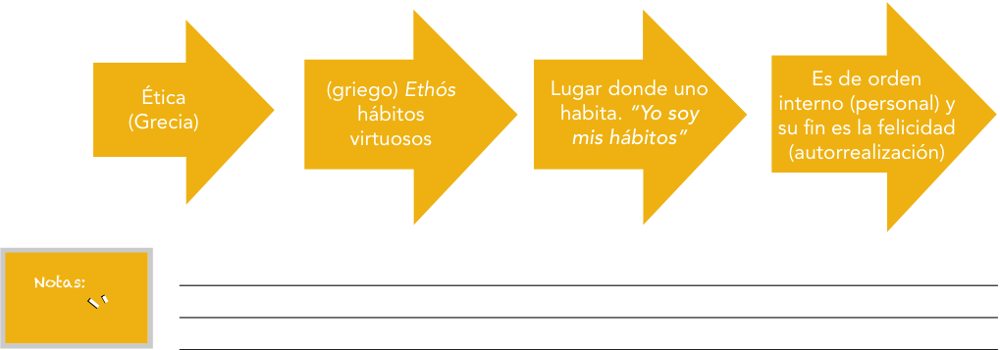
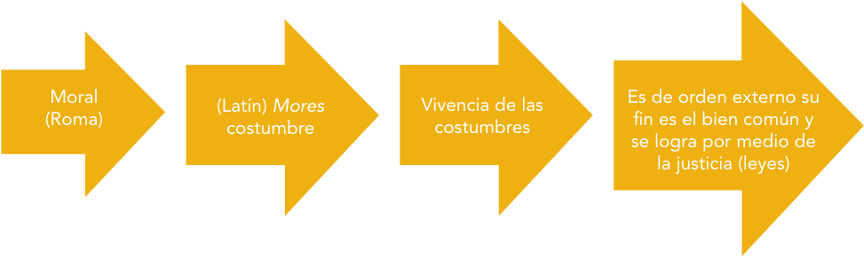
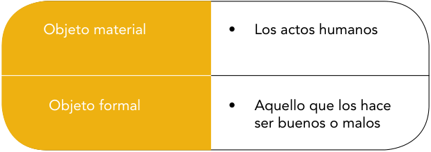
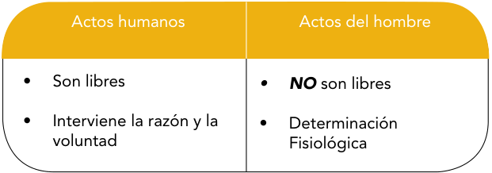
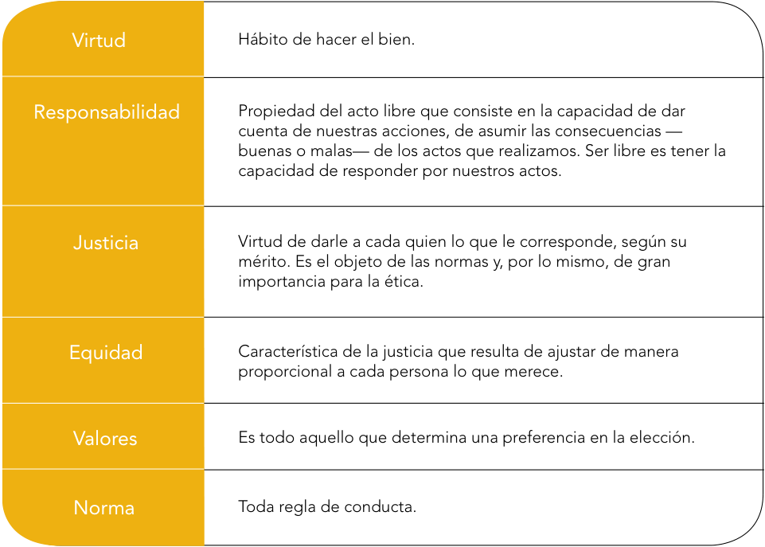
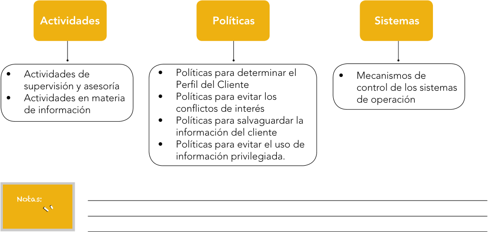
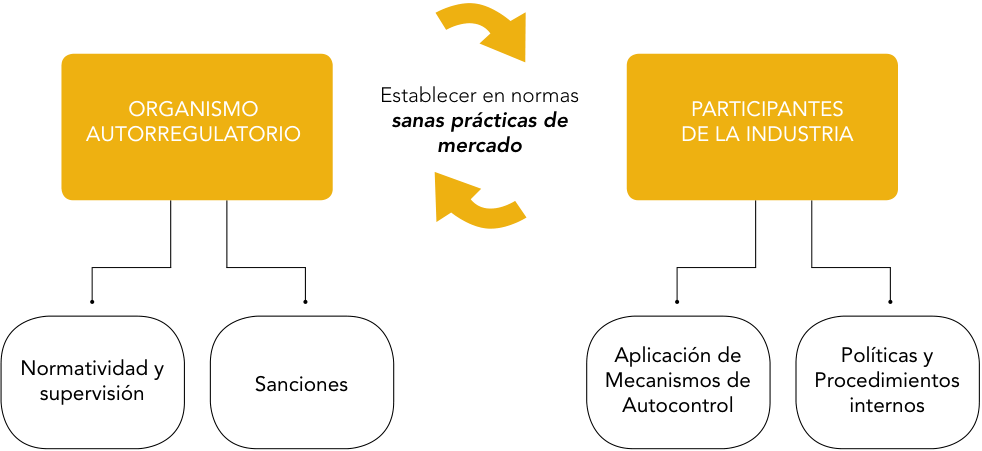
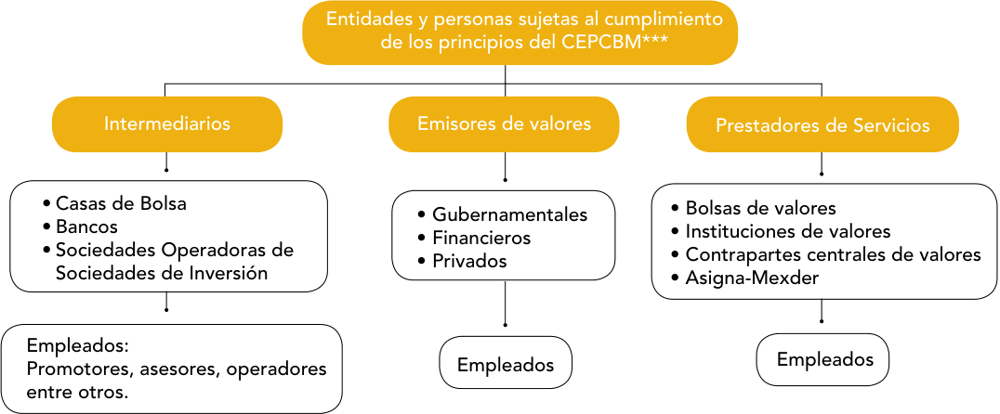

# Ética Bursátil y Sanas Prácticas del Mercado de Valores

> **Manual oficial AMIB** — figura EBSPMV.
> Fuente: `Manual EBSPMVweb.pdf` (84 páginas). Texto íntegro del manual;
> los marcadores `<!-- pag. N del PDF -->` corresponden 1:1 a las páginas del PDF.

## Índice

- [Introducción](#introduccion)
- [Objetivos Generales del Curso](#objetivos-generales-del-curso)
- [Módulo 1: Ética General](#modulo-1-etica-general)
  - [1.1 Entender la Ética](#11-entender-la-etica)
    - [1.1.1 Diferencia entre Ética y Moral](#111-diferencia-entre-etica-y-moral)
    - [1.1.2 Objeto de estudio de la ética](#112-objeto-de-estudio-de-la-etica)
    - [1.1.3 Actos Humanos y Actos del Hombre](#113-actos-humanos-y-actos-del-hombre)
  - [1.2 Conceptos básicos para entender la Ética](#12-conceptos-basicos-para-entender-la-etica)
    - [1.2.1 Relación de la Ética con los conceptos de Bien, Libertad, Virtud, Responsabilidad, Justicia, Equidad, Principios y Valores](#121-relacion-de-la-etica-con-los-conceptos-de-bien-libertad-virtud-responsabilidad-justicia-equidad-principios-y-valores)
    - [1.2.2 Relación entre Ética, Moral, Legalidad y Religión](#122-relacion-entre-etica-moral-legalidad-y-religion)
  - [1.3 Características y Beneficios de los principios éticos](#13-caracteristicas-y-beneficios-de-los-principios-eticos)
    - [1.3.1 Conciencia](#131-conciencia)
    - [1.3.2 Generalidad](#132-generalidad)
    - [1.3.3 Obligatoriedad](#133-obligatoriedad)
    - [1.3.4 Permanencia](#134-permanencia)
    - [1.3.5 No coerción externa](#135-no-coercion-externa)
    - [1.3.6 Principio de Totalidad](#136-principio-de-totalidad)
    - [1.3.7 Importancia y Utilidad de la Ética](#137-importancia-y-utilidad-de-la-etica)
  - [Ejercicio de repaso](#ejercicio-de-repaso)
- [Módulo 2: Ética de la Empresa](#modulo-2-etica-de-la-empresa)
  - [2.1 Empresa y Ética de la Empresa](#21-empresa-y-etica-de-la-empresa)
    - [2.1.1 Empresa](#211-empresa)
    - [2.1.2 Qué es Ética de la Empresa](#212-que-es-etica-de-la-empresa)
    - [2.1.3 Importancia del Capital Humano](#213-importancia-del-capital-humano)
  - [2.2 Fines de la empresa](#22-fines-de-la-empresa)
    - [2.2.1 Fines de la empresa como generadora de bienes](#221-fines-de-la-empresa-como-generadora-de-bienes)
    - [2.2.2 Por qué el fin no justifica los medios](#222-por-que-el-fin-no-justifica-los-medios)
  - [2.3 El líder moral en la empresa](#23-el-lider-moral-en-la-empresa)
    - [2.3.1  Exigencia ética de los líderes organizacionales](#231--exigencia-etica-de-los-lideres-organizacionales)
    - [2.3.2  Atributos del líder moral en la empresa](#232--atributos-del-lider-moral-en-la-empresa)
  - [Ejercicio de repaso](#ejercicio-de-repaso)
- [Módulo 3: Ética Bursátil](#modulo-3-etica-bursatil)
  - [3.1 Importancia de la Ética en el medio bursátil 3.1.1  Qué es Ética Bursátil](#31-importancia-de-la-etica-en-el-medio-bursatil-311--que-es-etica-bursatil)
    - [3.1.2 Actuación conforme a las sanas prácticas de mercado](#312-actuacion-conforme-a-las-sanas-practicas-de-mercado)
    - [3.1.3 Marco regulatorio en la prestación de servicios financieros](#313-marco-regulatorio-en-la-prestacion-de-servicios-financieros)
  - [3.2 La Responsabilidad Fiduciaria](#32-la-responsabilidad-fiduciaria)
    - [3.2.1  Actividades de supervisión y asesoría](#321--actividades-de-supervision-y-asesoria)
    - [3.2.2  Actividades en materia de información](#322--actividades-en-materia-de-informacion)
    - [3.2.3  Mecanismos de control de los sistemas de operación](#323--mecanismos-de-control-de-los-sistemas-de-operacion)
    - [3.2.4 Políticas para determinar el Perfil del Cliente](#324-politicas-para-determinar-el-perfil-del-cliente)
    - [3.2.5 Políticas para evitar conflictos de interés](#325-politicas-para-evitar-conflictos-de-interes)
    - [3.2.6 Políticas para salvaguardar la información del cliente](#326-politicas-para-salvaguardar-la-informacion-del-cliente)
    - [3.2.7 Políticas para evitar el uso de información privilegiada](#327-politicas-para-evitar-el-uso-de-informacion-privilegiada)
  - [3.3 Autorregulación y Organismos Autorregulatorios en el Mercado de Valores](#33-autorregulacion-y-organismos-autorregulatorios-en-el-mercado-de-valores)
    - [3.3.1  Necesidad y Finalidad de la autorregulación en el mercado de valores](#331--necesidad-y-finalidad-de-la-autorregulacion-en-el-mercado-de-valores)
    - [3.3.2 Organismos Autorregulatorios (OAR) y sus estándares](#332-organismos-autorregulatorios-oar-y-sus-estandares)
    - [3.3.3 La Asociación Mexicana de Intermediarios Bursátiles como Organismo Autorregulatorio](#333-la-asociacion-mexicana-de-intermediarios-bursatiles-como-organismo-autorregulatorio)
    - [3.3.4 Beneficios de la cultura de autorregulación y certificación](#334-beneficios-de-la-cultura-de-autorregulacion-y-certificacion)
  - [Ejercicio de repaso](#ejercicio-de-repaso)
- [Módulo 4: Código de Ética Profesional de la Comunidad Bursátil Mexicana](#modulo-4-codigo-de-etica-profesional-de-la-comunidad-bursatil-mexicana)
  - [4.1 Para qué un Código de Ética](#41-para-que-un-codigo-de-etica)
    - [4.1.1 Finalidad del código](#411-finalidad-del-codigo)
    - [4.1.2 A quién está dirigido el Código de Ética](#412-a-quien-esta-dirigido-el-codigo-de-etica)
    - [4.1.3 Responsabilidad del Profesional Bursátil](#413-responsabilidad-del-profesional-bursatil)
  - [4.2 Contenido del Código de Ética Profesional de la Comunidad Bursátil Mexicana](#42-contenido-del-codigo-de-etica-profesional-de-la-comunidad-bursatil-mexicana)
  - [4.3 Los Principios Fundamentales de Actuación y su aplicación](#43-los-principios-fundamentales-de-actuacion-y-su-aplicacion)
    - [4.3.1 Actúa de acuerdo con las disposiciones aplicables y las sanas prácticas de mercado](#431-actua-de-acuerdo-con-las-disposiciones-aplicables-y-las-sanas-practicas-de-mercado)
    - [4.3.2 Actúa con base en una conducta profesional íntegra que permita el desarrollo transparente y ordenado del mercado](#432-actua-con-base-en-una-conducta-profesional-integra-que-permita-el-desarrollo-transparente-y-ordenado-del-mercado)
    - [4.3.3 Haz prevalecer el interés de tu cliente](#433-haz-prevalecer-el-interes-de-tu-cliente)
    - [4.3.4 Evita los conflictos entre tu interés personal y el de terceros](#434-evita-los-conflictos-entre-tu-interes-personal-y-el-de-terceros)
    - [4.3.5 Proporciona al mercado información veraz, clara, completa y oportuna](#435-proporciona-al-mercado-informacion-veraz-clara-completa-y-oportuna)
    - [4.3.6 Salvaguarda la confidencialidad de la información de los clientes](#436-salvaguarda-la-confidencialidad-de-la-informacion-de-los-clientes)
    - [4.3.7 No uses ni divulgues información privilegiada](#437-no-uses-ni-divulgues-informacion-privilegiada)
    - [4.3.8 Compite en forma leal](#438-compite-en-forma-leal)
- [Ensayo de examen](#ensayo-de-examen)
    - [Sub área: Ética General](#sub-area-etica-general)
- [Sección de respuestas](#seccion-de-respuestas)
- [BIBLIOGRAFÍA](#bibliografia)

---

<!-- pag. 6 del PDF -->

> *“Siembra un acto y cosecharás un hábito. Siembra un hábito y cosecharás un carácter. Siembra un carácter y cosecharás un destino”.*
>
> — Charles Reade

<!-- pag. 7 del PDF -->

## Introducción

Las páginas siguientes aportan elementos de reflexión sobre la ética, dado que en la medida en que se profundice en su conocimiento, contribuirá en el desempeño del profesional bursátil con excelencia.

Para actuar éticamente, se requiere de una educación que lo facilite y para ello debe haber un orden en el proceso que conduzca desde los hábitos hasta la posesión de los valores éticos.

Cada quien tiene la experiencia de reflexionar sobre sus actos y preguntarse si son buenos o malos, y se ha planteado la pregunta “qué es lo que debo hacer” antes de decidir alguna cuestión de mayor o menor importancia para la propia vida. Por ejemplo, un empleado bursátil puede plantearse las preguntas: ¿Debo guardar la confidencialidad de la información que manejo o aprovecharla en beneficio propio o de algún cliente?, ¿Existe algún conflicto de interés si yo realizo negocios directamente con un cliente?, ¿Los deberes de lealtad que tengo para con la empresa en la que trabajo se verían lesionados si yo garantizo a mi cliente el rendimiento de una acción?

Para desahogar éstas y otras preguntas, a lo largo del texto conformado por cuatro módulos, desarrollaremos los temas que a continuación esbozamos, cuya cabal comprensión será de gran relevancia para el ejercicio de tu labor como profesional bursátil:

- Expondremos los conceptos generales de la ética, la forma de entenderlos y su vinculación con otros conocimientos que norman la conducta del hombre.

- También explicaremos los beneficios de la ética y las características de sus principios aplicados en las organizaciones, la manera en que influyen en la conducta de los colaboradores de una organización y la forma en que las empresas al cumplir sus finalidades ajustadas a la ética impactan el comportamiento de las personas.

- En particular en el medio bursátil, la aplicación de la ética se expresa especialmente a través de lo que conocemos como Responsabilidad Fiduciaria y la práctica de la Autorregulación, aspectos éstos en los que nos detendremos en el tercer módulo.

- Finalmente, nos adentraremos en el estudio del Código de Ética Profesional de la Comunidad Bursátil Mexicana, documento rector de los principios éticos y las sanas prácticas en nuestro mercado de valores.

Estamos convencidos que la ética debe estar presente en cada uno de nuestros actos por ser el único medio eficaz para contrarrestar la impunidad, la injusticia, la corrupción y los males que nos aquejan, contribuyendo en cambio a la generación de una sociedad más fuerte, justa, solidaria y exitosa. En consecuencia, la aplicación de la ética en las sanas prácticas del mercado, sin duda contribuirá a engrandecer a las personas que en él laboran y al mercado de valores en su conjunto.

<!-- pag. 8 del PDF -->

## Objetivos Generales del Curso

Al concluir el curso serás capaz de:

- Transferir los conceptos éticos para la toma de decisiones responsable, por medio de la práctica en situaciones – problema.

- Valorar la Ética como elemento rector de tu práctica profesional para desempeñarte con integridad en el ámbito bursátil por medio de la determinación del juicio crítico.

- Aplicar el Código de Ética Profesional de la Comunidad Bursátil Mexicana para integrarlo a tu comportamiento por medio de la vinculación de los principios establecidos en él.

<!-- pag. 9 del PDF -->

## Módulo 1: Ética General

Objetivo: Relacionar los conceptos generales de la ética para alinear el actuar personal y el compromiso a la práctica profesional.

### 1.1 Entender la Ética

#### 1.1.1 Diferencia entre Ética y Moral

**Origen Etimológico**

La palabra _ética_ viene del griego _ethos_ y hace referencia a los _hábitos virtuosos_ . La ética es la vivencia cotidiana de las virtudes y los valores que prevalecen cuando actuamos. Es decir, actuar éticamente es ajustar nuestros actos a las exigencias racionales del bien.

_Moral_ viene del latín _mores_ y se refiere al comportamiento o conducta del ser humano en relación a las _costumbres_ .

Desde un punto de vista filosófico y etimológico, _“ética”_ y _“moral”_ no tienen significado idéntico. La ética es un estudio científico y racional que observa a la vida moral como una totalidad y que la persona adopta a su propia conducta. La moral por su parte, es el conocimiento espontáneo que todos poseemos, es sólo una parte de la reflexión humana derivado de las costumbres.

**En qué se relacionan**

La ética y la moral buscan el _bien_ en relación a los actos humanos, pero la ética lo define, explica y fundamenta, mientras que la moral lo busca de manera más natural que filosófica.

Como podemos identificar en el siguiente esquema, la ética se origina en la antigua Grecia, su análisis es de orden interno, personal, mientras que su fin la _felicidad_ , esto es, la autorrealización.

> **Texto del esquema:** Es de orden Ética (griego) Ethós Lugar donde uno interno (personal) y hábitos habita. “Yo soy (Grecia) virtuosos mis hábitos” su fin es la felicidad (autorrealización)

<!-- pag. 10 del PDF -->

En este otro esquema se muestra cómo la moral que surge en Roma, explica el orden externo, esto es, social y su fin es el _bien común_ que se logra mediante la justicia y las leyes.

> **Texto del esquema:** Moral Es de orden externo su (Latín) Mores Vivencia de las (Roma) costumbre costumbres fin es el bien común y se logra por medio de la justicia (leyes)

#### 1.1.2 Objeto de estudio de la ética

**La Ética como ciencia práctica**

La ética es práctica porque aplica _principios_ generales de buena conducta a casos individuales donde interviene el libre albedrío.

**Objeto material y Objeto formal**

La ética como toda ciencia tiene un objeto general de estudio (objeto material) y un objeto específico de análisis (objeto formal):

> **Texto del esquema:** Objeto material • Los actos humanos Objeto formal • Aquello que los hace ser buenos o malos

**Tarea de la Ética**

Establecer _criterios racionales_ para actuar en función del bien, lo que implica a su vez una _evaluación de motivos y consecuencias_ . En la valoración de los actos humanos se trata de descubrir si un acto determinado es bueno, esto es, si construye o destruye al sujeto que lo realiza.

<!-- pag. 11 del PDF -->

#### 1.1.3 Actos Humanos y Actos del Hombre

**Qué son los Actos del Hombre**

Los actos del hombre _no son libres_ , ya sea porque se realizan sin conocimiento o voluntad o porque se trata de actos que derivan de una determinación fisiológica. Por ejemplo: _comer, dormir, caminar._

**Qué son los Actos Humanos**

En los actos humanos nosotros elegimos realizar o no alguna acción. Son las _acciones libres_ que proceden de un análisis _racional_ (conocimiento) y _voluntario_ (querer hacerlo). Si los actos humanos son libres, entonces nosotros somos los dueños y creadores de nuestra conducta, lo que implica que tenemos que asumir la responsabilidad de cada una de nuestras decisiones.

> **Texto del esquema:** Actos humanos Actos del hombre • Son libres • NO son libres • Interviene la razón y la • Determinación voluntad Fisiológica

**Elementos del Acto Humano**

En virtud de que el acto humano es el objeto material de estudio de la ética, tiene tres elementos:

- Objeto: La acción que se realiza.

- Fin: Intención del sujeto.

- Circunstancia: Condición externa al sujeto y al acto en las que el mismo decide realizar la acción.

El elemento del acto humano que sólo puede ser conocido directamente por la conciencia personal es el _fin_ que es la dirección que pretende seguir el sujeto con cada acción que realiza, es la intención que tiene para concretarla. Fuera de la conciencia, los elementos del acto realizado son el objeto ( _acción_ ) y las circunstancias ( _condiciones externas_ ).

<!-- pag. 12 del PDF -->

**La ética desde el punto de vista filosófico**

Ciencia que estudia los actos humanos en cuanto se relacionan con los fines que determinan su plenitud. Las buenas intenciones no son suficientes para calificar la plenitud ética de los actos. Es necesario saber en qué consiste el bien y el mal; es decir, conocer previamente a la realización de los actos sus consecuencias y lo que implican.

**Condiciones para que el acto humano sea bueno**

Los elementos del acto humano deben ser buenos para que el acto lo sea, es decir, debe dirigirse al bien, porque es todo aquello que perfecciona la esencia de la persona. Así pues, para que el acto sea éticamente malo, basta con que cualquiera de los tres elementos lo sea.

### 1.2 Conceptos básicos para entender la Ética

#### 1.2.1 Relación de la Ética con los conceptos de Bien, Libertad, Virtud, Responsabilidad, Justicia, Equidad, Principios y Valores

**Qué es el bien**

_“Es lo que perfecciona la naturaleza de una cosa o la esencia de la persona y lo malo lo que atente contra su naturaleza_ ”. El bien funciona como _centro totalizador_ de nuestra conducta, ya que siempre que hacemos algo es con la intención de obtener un bien o lo que suponemos que lo es, aunque no siempre así sea.

**Materia de estudio de la ética**

En nosotros existen inclinaciones naturales para realizar ciertos actos, pero aprender qué es lo que debo o no hacer en cada momento, es materia de estudio de la ética. Para ser pleno y feliz no basta con tener una “buena intención”, es necesario también, ordenar -mediante la razón- los actos de la voluntad para que la acción sea buena. Al buscar el bien en nuestras acciones, seremos felices y nos realizaremos.

<!-- pag. 13 del PDF -->

Qué son los principios

**Qué es la libertad**

**Qué es la virtud**

**Cómo alcanzar la virtud**

A lo largo de la historia se fue descubriendo que existen principios que son fundamentales, ya que son las razones que explican el porqué se actúa de determinada manera.

Por ejemplo: _decir la verdad, respetar las vidas y propiedades ajenas, etc., convirtiéndose en universales, como la confianza que se ve reflejada en la responsabilidad fiduciaria y los principios generales del Código de Ética Profesional de la Comunidad Bursátil Mexicana._

Cualidad de la voluntad mediante la cual _elegimos_ entre dos o más bienes y deriva de nuestra racionalidad.

En tanto se es libre cada uno es el verdadero autor de su conducta.

El hábito que adquirimos de _hacer el bien_ . La naturaleza de la virtud nos dice que el bien debe ser el punto de referencia de nuestro comportamiento. De esta manera el actuar bien se construye cuando repetimos actos virtuosos.

El hombre virtuoso busca el _justo medio_ entre sus emociones, pasiones y acciones por medio de su razón porque es la que debe orientar nuestro actuar, pues de esta manera llegaremos a la felicidad, que como fin de la ética, viene de la satisfacción del “deber” cumplido.

<!-- pag. 14 del PDF -->

**Síntesis de los conceptos revisados**

|Ética|Ciencia práctica que estudia los actos humanos en cuanto buenos o malos.|
|---|---|
|Moral|Conjunto de normas y costumbres que se trasmiten de generación en generación porque su vivencia identifica los valores indispensables del orden social.|
|Acto Humano|Acciones libres que proceden de un análisis racional y voluntario de quien las realiza.|
|Acto del Hombre|Actos determinados por leyes fisiológicas, que carecen de inteligencia, voluntad y libertad.|
|Bien|Es lo que perfecciona la naturaleza de una cosa o la esencia de la persona.|
|Principios|Razones básicas de las que parte el conocimiento para llevar a cabo los actos humanos.|
|Libertad|Cualidad de la voluntad mediante la cual elegimos entre dos o más opciones y por la cual somos los verdaderos autores de nuestra conducta.|

<!-- pag. 15 del PDF -->

Para comprender mejor la ética, agregamos los siguientes conceptos relacionados con la misma:

> **Texto del esquema:** Virtud Hábito de hacer el bien. Responsabilidad Propiedad del acto libre que consiste en la capacidad de dar cuenta de nuestras acciones, de asumir las consecuencias — buenas o malas— de los actos que realizamos. Ser libre es tener la capacidad de responder por nuestros actos. Justicia Virtud de darle a cada quien lo que le corresponde, según su mérito. Es el objeto de las normas y, por lo mismo, de gran importancia para la ética. Equidad Característica de la justicia que resulta de ajustar de manera proporcional a cada persona lo que merece. Valores Es todo aquello que determina una preferencia en la elección. Norma Toda regla de conducta.

<!-- pag. 16 del PDF -->

#### 1.2.2 Relación entre Ética, Moral, Legalidad y Religión

Normas, prescripciones y deber A pesar de que ética, moral, legalidad y religión tratan de normas, ser prescripciones y deber ser, no significan lo mismo.

**Diferencia de conceptos**

Ética La _ética_ es una ciencia que se concreta en un conjunto de normas que cada sujeto reconoce como válidas racionalmente, su causa entonces es _interna_ y de ahí su _autonomía_ .

Moral La _moral_ es un conjunto de normas que la sociedad se encarga de transmitir de generación en generación y que constituyen valores socialmente aceptados. Es producto de una causa _externa_ , de ahí su carácter de _heterónoma_ .

Legalidad La _legalidad_ es característica de la ley. Lo ético y lo moral no versan sobre los límites de lo legal o ilegal. El significado de _legalidad_ es lo que es conforme a derecho, mismo que pretende establecer los _parámetros de la justicia_ que es darle a cada quien lo que le corresponde. La norma jurídica _establece un orden social obligatorio_ , no sujeto a la voluntad personal como la ética. La legalidad se caracteriza por aplicarse al hombre de manera externa.

Religión Mientras que la conciencia juzga la ética de un acto y el derecho juzga la legalidad del mismo, la _religión_ se distingue de las anteriores nociones porque es una _práctica de fe_ , una vivencia personal.

<!-- pag. 17 del PDF -->

**Diferencia de conceptos**

|Normas Éticas|Normas Morales|Normas Legales|Normas de la Religión|
|---|---|---|---|
|• Normas de actuación que una persona adopta por convencimiento para lograr su perfeccionamiento.|• Normas que la sociedad se encarga de transmitir de generación en generación, porque identifica en la vivencia de esas acciones los valores indispensables del orden social.|• Normas basadas en las leyes, conforme a derecho, y que tienen carácter coercitivo.|• Normas que se derivan de la fe que vinculan al hombre con Dios y orientan los actos humanos de quien vive esa fe.|
|Son normas_internas_|Son normas_externas_|Son normas_externas_||

<!-- pag. 18 del PDF -->

### 1.3 Características y Beneficios de los principios éticos

#### 1.3.1 Conciencia

**Todo principio ético supone**

Que la persona actúa guiada por su sentido común y por el conocimiento de las normas que son aplicables a su actividad.

#### 1.3.2 Generalidad

Los principios éticos se aplican de manera universal a cualquier profesión

Cada profesión supone un _deber ser,_ que en esencia es el mismo para todas las actividades humanas.

Para que una profesión tenga valor ético debe perfeccionar la naturaleza humana con los actos concretos que cada profesionista hace, de manera que cuando alguna persona degrada la naturaleza humana con su actuación profesional, no puede considerarse éticamente bueno, aun cuando se haga con gran perfección y arte.

#### 1.3.3 Obligatoriedad

**Obligatoriedad de la norma ética**

La obligatoriedad de la norma ética es _autónoma e interna_ porque es propia de nuestra conciencia individual. Nosotros nos auto-imponemos normas, somos nuestra propia autoridad.

La etimología del vocablo autonomía, viene del griego _autos_ : sí mismo y _nomos_ : ley; lo que significa ley que proviene de uno mismo.

<!-- pag. 19 del PDF -->

**Obligatoriedad de la norma jurídica**

Se explica mediante el carácter bilateral que posee, pues yo no soy el autor de esas normas que tengo que respetar. Cuando una persona cumple una norma que ella misma se ha impuesto, dicho cumplimiento no implica una obligación de otra persona hacia ella, como sí sucede en el derecho. Una obligación corresponde a un derecho y viceversa, como en los contratos, en los cuales las partes que lo celebran tienen derechos, pero también obligaciones.

**Relación entre la norma ética y la norma jurídica**

La obligatoriedad de la norma ética no es de carácter legal, sino individual, pero el derecho y la ética se pueden entrelazar y en este sentido existe cierta legitimidad jurídica en la ética. Realizar los deberes de un contrato con buena intención, legalmente no tiene mérito, pero sí éticamente. Es nuestra obligación ética realizar acciones con objetos, circunstancias y fines buenos.

||Las normas éticas son:|Las normas jurídicas son:|
|---|---|---|
|_•_|_Autónomas e internas_, provienen de uno mismo|_•_ _Externas_, provienen de fuera|
|•|Se obligan a nivel de_conciencia_ _individual_|• Las tengo que cumplir|
|•|Son_unilaterales_|• Son_bilaterales_|

<!-- pag. 20 del PDF -->

#### 1.3.4 Permanencia

Conservación de las normas Las normas éticas se conservan en sus principios a lo largo del éticas tiempo.

#### 1.3.5 No coerción externa

**Inexistencia de sanción externa en las normas éticas**

Las normas éticas carecen de sanción externa porque atienden al cumplimiento que el hombre debe hacer de sus principios, para autorrealizarse, ser pleno y feliz.

#### 1.3.6 Principio de Totalidad

Las acciones son el reflejo del El carácter de totalidad de la ética se da porque todas nuestras propio ser acciones reflejan nuestro ser, de manera que la debemos aplicar siempre y en todo momento.

No puede existir una ética para la familia y otra para el trabajo, ni una aplicación discriminada hacia ciertos clientes por encima de otros, ni una moral para el jefe y otra para el empleado.

#### 1.3.7 Importancia y Utilidad de la Ética

**Educación en la Ética**

Practicar la ética como parte de nuestras vidas tiene muchos beneficios. Pero primero tenemos que aprender a desarrollar las virtudes que nos permitan aplicar la ética. La educación en la ética implica la adquisición de conocimientos y la formación de hábitos. Adquirir buenos hábitos nos otorga libertad y congruencia entre lo que quiero y lo que debo hacer.

<!-- pag. 21 del PDF -->

Cómo desarrollar la ética La ética se acrecienta cuando se ejercita bien, de manera que los buenos hábitos se ponen en práctica en cada acto que realizamos libremente hasta llegar a ser virtuoso.

1. Ampliar nuestros conocimientos.

2. Aplicar estos conocimientos.

3. Practicar, repetir hábitos hasta formar virtudes y costumbres para vivir bien.

Beneficio personal de contar con conocimientos de ética

- Con ella se logra autonomía, madurez y ser dueño de sí mismo.

- Proporciona un amplio criterio en la toma de decisiones.

- Ayuda a tener coherencia y consistencia en los actos.

- Nos hace mejores personas.

- Permite que nuestras instituciones sean más sólidas, más eficientes, más exitosas y más prósperas por quienes laboramos en ellas.

> **_“Feliz quien tiene hábitos con qué vestir y en qué habitar y no anda a la intemperie del espíritu y sabe qué decir y qué pensar”._**

> **Gabriel Zaid**

<!-- pag. 22 del PDF -->

### Ejercicio de repaso

Instrucciones:

Relaciona ambas columnas de los conceptos de Ética General escribiendo en el paréntesis el número de la columna “A” que corresponda a cada concepto de la columna “B”.

||**A**||**B**|
|---|---|---|---|
|1.- |Busca el bien en relación con la bondad de los actos humanos.|(     )|Principios|
|2.- |Hábito de hacer el bien por convencimien- to.|(     )|Equidad|
|3.- |Centro totalizador de nuestra conducta para realizarnos y ser felices.|(     )|Justicia|
|4.- |Capacidad de elegir entre dos o más bienes.|(     )|Actos humanos|
|5.-   |Acciones que se pueden realizar sin cono- cimiento o por determinaciones biológi- cas.|(     )|Responsabilidad|
|6.- |Busca el bien en relación con el logro del Bien Común.|(     )|Bien|
|7.- |Acción libre que se elige realizar o no con base en un análisis racional y voluntario.|(     )|Valores|
|8.-   |Propiedad del acto libre que da cuenta de las acciones e implica asumir sus conse- cuencias.|(     )|Ética|
|9.- |Virtud de darle a cada quien lo que le corresponde, según su mérito.|(     )|Virtud|
|10. |- Es todo aquello que determina una pre- ferencia en la elección.|(     )|Moral|
|11.   |- Característica de la justicia que resulta de ajustar de manera proporcional a cada persona lo que merece.|(     )|Libertad|
|12. |- Son las razones básicas de las que parte el conocimiento para realizar un acto.|(     )|Actos del hombre|

<!-- pag. 23 del PDF -->

## Módulo 2: Ética de la Empresa

Objetivo: Integrar por medio de principios, valores y normas éticas una ordenación a las políticas y procedimientos de la cultura de la institución.

### 2.1 Empresa y Ética de la Empresa

#### 2.1.1 Empresa

**Qué significa empresa**

El término empresa viene de _emprender_ , lo que significa que estamos en presencia de la realización de un _acto creativo, innovador y cuyo objetivo consiste en cubrir una insuficiencia_ , una carencia o necesidad social.

Está conformada por una comunidad de personas capaz de generar riqueza, de responder a necesidades sociales y de evaluar las dimensiones de su productividad. Esto en la medida en que se plantee como una institución legitimada en el marco de unos principios éticos compartidos por quienes nos relacionamos con ella.

Una empresa es una comunidad en la que, además de crear e innovar, se cumple con una función social procurando vivir la cooperación y la justicia.

**Generación de un proyecto de empresa**

Para que se lleve a cabo es indispensable que siente sus bases en principios, mismos que tienen implicaciones éticas. Es crucial para salir adelante que los principios queden plasmados en un Código de Ética.

<!-- pag. 24 del PDF -->

#### 2.1.2 Qué es Ética de la Empresa

**Qué es Ética de la Empresa**

Son todos aquellos _principios, normas y valores_ que la organización define para orientar el comportamiento de sus colaboradores. Cuando una persona se integra a una empresa, asume estos principios como suyos.

**Relación entre ética de la empresa y moral cívica**

La ética de la empresa toma en cuenta la _moral cívica_ en la que se desarrolla, ya que reconoce determinados _valores y derechos compartidos_ por la sociedad porque se encuentra inmersa en un contexto social.

**Los intermediarios bursátiles**

Los intermediarios bursátiles, como toda organización, no se reducen a la suma de sus miembros, sino que deben _cumplir unas funciones y asumir claras responsabilidades sociales_ , sin que esto implique que la responsabilidad de los individuos que la conforman se diluya en el conjunto de los fines empresariales. De esta manera la ética bursátil no es solamente individual, sino también social.

#### 2.1.3 Importancia del Capital Humano

**El valor de la persona en la empresa**

Todos somos responsables de las acciones que realizamos en la empresa para conseguir los objetivos y los medios para lograrlo. La finalidad del intermediario bursátil es contribuir al bien común en el ámbito que le corresponde, y esto se logra en la medida en que reconozcamos el _valor de las personas_ que laboran en ella, puesto que son el _agente transformador_ en la organización.

<!-- pag. 25 del PDF -->

Continúa ...

_Toda persona es un fin en sí misma y no un medio para lograr los fines de la empresa_ , pues lo que aportamos a ésta, no lo hará del mismo modo otra persona, de manera que el valor de las personas como generadoras de riqueza se acentúa en la medida en que se trata de empresas que prestan servicios, como es el caso del medio bursátil, donde la actuación de los profesionales es determinante en la _creación del valor agregado_ .

### 2.2 Fines de la empresa

#### 2.2.1 Fines de la empresa como generadora de bienes

**Objetivo primordial de la empresa**

Las organizaciones humanas se crean para mejorar alguna condición preexistente en el entorno social para lo cual crean bienes y servicios.

Esto es lo que legitima su existencia ante la sociedad. A diferencia de las personas, cuya existencia no requiere legitimación, las organizaciones sí lo necesitan hacer.

Revisemos las cuatro finalidades de las organizaciones, dos de ellas relacionadas con los resultados económicos y dos con la aportación social.

||**Finalidades**|**de la empresa**|
|---|---|---|
||Finalidad económica|Finalidad social|
|Para la empresa misma|• Generar riqueza suficiente para los integrantes de la empresa|• Propiciar el desarrollo humano de los integrantes de la empresa|
|Para la comunidad|• Generar riqueza para los integrantes de la comunidad|• Propiciar el desarrollo de los integrantes de la comunidad|

<!-- pag. 26 del PDF -->

|Finalidades internas|• Generar riqueza suficiente para los integrantes de la empresa. Esto es generar la_rentabilidad_de la organización, su permanencia y, por supuesto, recompensar a los colaboradores de ésta. • Propiciar el_Desarrollo Humano_de los integrantes de la empresa. Formar y desarrollar habilidades, carácter y virtudes en los colaboradores.|
|---|---|
|Finalidades externas|• Generar_riqueza_para los integrantes de la comunidad, a través de proporcionar bienes y servicios razón por la que se creó. • Propiciar el_desarrollo_de los integrantes de la comunidad. Lo cual significa aportar beneficios a la comunidad más allá de los bienes y servicios que ofrece. En esta finalidad se da sentido a las acciones de beneficios a la comunidad en las que se establece la organización.|
|La empresa mejora condiciones preexistentes|El objetivo primordial de una empresa es mejorar condiciones preexistentes en su entorno social. Tal mejora persigue la obtención de ciertos_bienes sociales_, que se concretarán en el_bienestar común_. El capital ocupa un segundo plano en la empresa, porque la verdadera creación de riqueza reside en el trabajo que aportan las personas. Para que una empresa progrese requiere que los principios sobre los que se cimienta el trabajo sean firmes, coherentes, consistentes y relacionados con el objetivo por el cual fue creada.|

<!-- pag. 27 del PDF -->

Responsabilidad de la empresa Generar bienes sociales y a ese fin debe enfocar sus esfuerzos, de manera que con los bienes que produce o los servicios que presta, en verdad contribuya a la satisfacción de necesidades sociales.

#### 2.2.2 Por qué el fin no justifica los medios

**Beneficios legítimos para la empresa**

La empresa debe obtener beneficios, pero no puede hacerlo a costa de los derechos de los empleados, de los consumidores o de los proveedores; ni el beneficio de los miembros de la empresa puede pasar por delante de los derechos de las personas. Toda empresa debe lograr legitimidad social a través de producir los bienes que de ella se esperan, respetar los derechos reconocidos por la sociedad en la que vive y los valores que esa sociedad comparte.

Proporción entre medios Como el fin no justifica los medios, a pesar de que se tenga un y fines buen fin, una buena intención, si los medios no son también buenos, no lo son los actos de la empresa. La empresa debe cuidar que sean legítimos tanto sus fines, como los medios que utilice para llegar a ellos. La proporción entre medios y fines es la regla y criterio seguro para entender que ambos deben ser adecuados; no se pueden utilizar medios ilícitos para fines personales. Es necesario que exista un equilibrio o proporción que tenga presente que la empresa está para servir a la sociedad y que éste es el sentido que le da permanencia.

**Fórmula entre medios y fines**

**Fin lícito + Medios lícitos = Acto ético Fin lícito +** Medios ilícitos **= Acto ilícito** Fin ilícito **+ Medios lícitos = Acto ilícito** Fin ilícito **+** Medios ilícitos **= Acto ilícito**

<!-- pag. 28 del PDF -->

### 2.3 El líder moral en la empresa

#### 2.3.1  Exigencia ética de los líderes organizacionales

Identidad empresarial El directivo es un factor decisivo para que la empresa se convierta en un espacio ético. En ella colaboran un grupo de personas que comparten su tiempo proponiéndose unas metas comunes y generando un _ethos (costumbres virtuosas o hábitos)_ que les otorga identidad empresarial. A mayor jerarquía dentro de una empresa, son mayores sus facultades, pero también son mayores sus responsabilidades. Los valores en la empresa Los valores deben prevalecer en la empresa porque son los que orientan la conducta hacia cómo se desarrolla el trabajo. Uno de los valores de la empresa es el trabajo en equipo. La cooperación entre directivos y empleados es posible gracias a los roles que ejerce cada uno, misma que debe estar fundada en la confianza y el compañerismo, porque independientemente de la existencia de una necesaria jerarquía, todos los integrantes del equipo tienen derechos, aunque diversas responsabilidades y en consecuencia, alcances distintos en cuanto a su poder de decisión. El líder en la empresa Tendrá que ser un líder moral, capaz de hacerse seguir por otros y lograr de ellos identificación y adhesión a las causas que él pretende conseguir. Lo que más convence y atrae de un líder es la consistencia entre sus palabras y sus actos, por ello, es característica propia del líder dejarse aconsejar y saber rectificar. En el medio empresarial los líderes tienen una función determinante para la sociedad, porque son el motor, la fuerza emocional capaz de sacar adelante un proyecto por difícil o imposible que parezca, para lograr los fines de la empresa, generando empleos y abriendo cauces al desarrollo.

<!-- pag. 29 del PDF -->

Continúa ... Se concluye que un líder empresarial ha de ser primero un líder moral, una persona capaz de credibilidad y de compromiso social.

**La credibilidad en el líder**

Se funda en el testimonio de sus palabras que refrenda con sus actos, de manera que una persona con autoridad formal dentro de la empresa, no necesariamente es líder, porque posiblemente carece de consistencia entre sus actos y sus dichos, y paradójicamente una persona sin altos niveles de autoridad formal dentro de la empresa, puede tener frente a sus compañeros un alto impacto de líder moral por su coherencia.

Proporción de la exigencia ética La exigencia ética es proporcional a la _educación_ y preparación que se posee, mientras más educación, se exige más responsabilidad, tanto profesional como ética. Quien ha recibido una educación integral debe asumir mayores responsabilidades, haciéndose consciente de las consecuencias de sus actos. En este sentido, un directivo ejerce una función irremplazable ya que debe estar preparado para el momento de tomar decisiones. El directivo debe saber que los principios éticos no tienen una aplicación unívoca para la resolución de problemas, de hecho los problemas éticos requieren de alguien con criterio para resolverlos, mismo que es posible únicamente si se adquiere la virtud de la _prudencia_ . La prudencia es la virtud de la recta razón que conduce a actuar con precisión en el momento adecuado.

<!-- pag. 30 del PDF -->

#### 2.3.2  Atributos del líder moral en la empresa

En resumen El líder empresarial debe ser un líder moral y, para poder cumplir con esta cualidad, requiere de los siguientes atributos:

Virtud de discernir lo bueno de lo malo y en cada caso concreto. Prudencia La prudencia permite analizar si además del fin del acto humano, lo es también su objeto y sus circunstancias.

Mientras más alta jerarquía tiene un líder, mayor libertad de acción tiene y, por lo tanto, es mucho mayor su responsabilidad. A mayor Responsabilidad educación, es mayor la conciencia de la consecuencia de sus actos, por lo mismo, también mayor es la responsabilidad. La credibilidad del líder se funda en el testimonio de sus palabras Credibilidad que se refrenda en sus actos. De no contar con ella, deja de ser líder moral para ser únicamente líder formal.

Es asumir las responsabilidades y obligaciones contraídas. El líder Compromiso debe lograr el compromiso de sus colaboradores con el ejemplo.

<!-- pag. 31 del PDF -->

### Ejercicio de repaso

Instrucciones:

Relaciona ambas columnas de los conceptos de Ética de la Empresa escribiendo en el paréntesis el número de la columna “A” que corresponda a cada concepto de la columna “B”.

**Columna A**

**Columna B**

|1.- Permite lograr la permanencia de la em- presa.|(     )|Ética de la empresa|
|---|---|---|
|2.- Principal atributo del líder moral.|(     )|Líder Moral|
|3.- Proporcionalidad entre educación, responsabilidad y exigencia ética. A mayor educación mayor responsabilidad.|(     )|Compromiso|
|4.- Uno de sus fines es cubrir una necesidad social.|(     )|Capital Humano|
|5.- Aplica principios y reconoce valores y derechos en un contexto social.|(     )|Prudencia|
|6.- Una de sus características es la consisten- cia entre sus palabras y sus acciones.|(     )|Principios|
|7.- Valor sustancial de la empresa para alcan- zar sus fines.|(     )|Empresa|
|8.- Se encuentran plasmados dentro del Có- digo de Ética.|(     )|Confianza|
|9.- Valor en el que se cimienta el buen desen- volvimiento de cada uno de los miembros de la empresa.|(     )|Exigencia ética|
|10.- Asumir las responsabilidades y obligacio- nes contraídas.|(     )|Proporción entre medios y fines|

<!-- pag. 32 del PDF -->

Ejercicio de repaso

Instrucciones:

Responde a las siguiente preguntas de acuerdo con tu propia opinión. Al terminar compara las ideas con tus compañeros y establezcan una conclusión. En el caso de la segunda pregunta, elijan un caso para comentar en la sesión plenaria.

1. ¿Cuáles son los asuntos más importantes a considerar en el tema de ética en las organizaciones?

2.  Establece un caso práctico en el que un fin no justifique los medios:

<!-- pag. 33 del PDF -->

## Módulo 3: Ética Bursátil

Objetivo: Identificar a la Ética Bursátil como el fundamento de la Autorregulación y su impacto en las sanas prácticas de mercado.

### 3.1 Importancia de la Ética en el medio bursátil 3.1.1  Qué es Ética Bursátil

**El impacto de la actividad bursátil Compromiso de responsabilidad**

La actividad bursátil impulsa el desarrollo económico del país, movilizando los bienes financieros para diversos proyectos de gran alcance y con objetivos propios según las necesidades específicas a corto, mediano y largo plazo. Gracias a ella se beneficia toda la sociedad lo que favorece el bien común. Así, los valores éticos que deben considerarse en la actividad económica involucran a los participantes del sector bursátil, ya sean entidades o personas, debiendo reflejar una conducta impecable tanto al interior de las instituciones como frente a quién actúan, proveedores y, muy particularmente para nuestros propósitos, frente a sus clientes. El manejo y administración del patrimonio de terceros - producto de su esfuerzo - impone a las instituciones financieras y a los profesionales bursátiles una responsabilidad extraordinaria. En la actividad bursátil a la que nos dedicamos se manifiesta el doble compromiso de la ética, es decir, la doble responsabilidad que asumimos ante uno mismo pero también frente a los demás. De ahí que debamos atender los principios éticos con el mismo cuidado que ponemos en alcanzar los objetivos o resultados de la institución con la que estamos vinculados.

<!-- pag. 34 del PDF -->

#### 3.1.2 Actuación conforme a las sanas prácticas de mercado

**Qué es una sana práctica**

Buenas prácticas generan buenos resultados en el corto y en el largo plazo, esto es, una sana práctica se logra mediante la repetición de actos aceptados por la comunidad bursátil porque _generan beneficios a todos los participantes: al cliente, a la institución y al mercado en general_ , y de esta manera le dan fortaleza y sustentabilidad al mercado.

Estas sanas prácticas son, por ejemplo:

- Guardar confidencialidad respecto a la información del cliente.

- Proporcionar a los clientes sólo la información pública respecto de las emisoras del mercado de valores.

- Considerar el perfil del cliente para hacerle sugerencias de inversión.

- Dar información al cliente para entender los riesgos y los beneficios de los diversos instrumentos.

- Llevar un control de las operaciones que permita tomar decisiones adecuadas en el futuro.

- Evitar que un promotor pueda ser cotitular de cuentas de parientes y de clientes, entre muchas otras.

Relación de las sanas prácticas Las sanas prácticas están totalmente relacionadas con la ética, ya con la ética que buscan lograr el bien de todos los participantes del mercado de valores.

Basados en las sanas prácticas las instituciones han establecido los principios que integran el Código de Ética Profesional de la Comunidad Bursátil Mexicana.

<!-- pag. 35 del PDF -->

#### 3.1.3 Marco regulatorio en la prestación de servicios financieros

Obligaciones de los Los participantes del mercado de valores fundamentan su participantes del mercado de actuación, además de en los principios generales referidos, en valores el marco regulatorio expresado en las Leyes emitidas por el Congreso de la Unión, fundamentalmente:

- Ley del Mercado de Valores

- Ley de Instituciones de Crédito

- • Ley de Sociedades de Inversión

Estas leyes se complementan con las disposiciones generales que emite la Comisión Nacional Bancaria y de Valores (CNBV), autoridad que regula la actividad bursátil y supervisa a las entidades del mercado de valores.

Niveles regulatorios adicionales A su vez, este marco regulatorio público se ve también complementado con dos niveles regulatorios adicionales:

1. El emitido por el Organismo Autorregulatorio (AMIB), y

2. Las políticas y procedimientos con que cuenta cada institución del medio bursátil, casa de bolsa, banco o sociedad operadora de sociedades de inversión (intermediarios bursátiles).

A qué deben ajustarse La labor de los intermediarios y de su personal debe ajustarse en los intermediarios y su personal todo momento a:

- Los principios éticos,

- Las leyes y disposiciones –Circulares – emitidas por la CNBV,

- Las normas emitidas por el organismo autorregulatorio, y

- Las políticas y procedimientos de la institución bursátil particular.

<!-- pag. 36 del PDF -->

### 3.2 La Responsabilidad Fiduciaria

Qué significa Responsabilidad Fiduciaria

**Cómo se manifiesta la Responsabilidad Fiduciaria**

Según su origen etimológico lo fiduciario proviene del latín _fides Fe – confianza._ La entendemos como aquella _obligación extraordinaria que asume una institución financiera y su personal frente a su clientela, derivada de la fe – confianza – que ésta deposita en la institución para el manejo de sus recursos._

El cliente de un intermediario bursátil, tiene confianza en el manejo eficiente y transparente de sus recursos por parte de la institución, recursos valiosos por ser el producto de su esfuerzo y por ser también los que le ayuden a cumplir sus objetivos de seguridad, educación, descanso o cualquier otro. A estos valores superiores debe responderse con una responsabilidad también superior, la responsabilidad fiduciaria. Esta _responsabilidad fiduciaria obliga_ a las instituciones financieras y a su personal a _manejar los recursos de la clientela como si fueran propios_ , lo que supone entender sus necesidades y requerimientos específicos para satisfacerlos buscando la mejor opción.

**Medidas adoptadas por instituciones bursátiles**

> **Texto del esquema:** Actividades Políticas Sistemas • Actividades de • Políticas para determinar el • Mecanismos de supervisión y asesoría Perfil del Cliente control de los sistemas • Actividades en materia • Políticas para evitar los de operación de información conflictos de interés • Políticas para salvaguardar la información del cliente • Políticas para evitar el uso de información privilegiada.

<!-- pag. 37 del PDF -->

#### 3.2.1  Actividades de supervisión y asesoría

**Procedimientos**

Las instituciones bursátiles tienen establecidos procedimientos y medidas de control adecuados para asegurarse que los profesionales vinculados con ellos cumplan con la normatividad aplicable a las distintas actividades en las que intervienen. Las instituciones cuentan con instancias adecuadas - contraloría normativa, asesor del inversor, auditoria - que realizan entre otras las siguientes actividades:

- Orientan a su personal en la manera de proceder ante cualquier duda que puedan tener respecto de la aplicación de la normatividad externa o interna,

- Verifican que los profesionales bursátiles ofrezcan a la clientela las mejores opciones de inversión de acuerdo con el perfil particular de cada cliente,

- Verifican constantemente que su personal de promoción, y a través de ellos sus clientes, entiendan todos los elementos que conforman su estado de cuenta, para que en caso contrario procedan a explicarlos puntualmente.

De esta manera y conforme a los conocimientos hasta aquí desarrollados, tú como profesional bursátil podrás evaluar si el objeto, el fin y las circunstancias de cierto acto, propio o de terceros, es correcto.

#### 3.2.2  Actividades en materia de información

**Elementos para orientar al cliente**

Las instituciones bursátiles cuentan con áreas de información y análisis sobre productos y servicios para orientar las decisiones de su clientela, tales como folletos, prospectos informativos y materiales diversos, tablas o calendarios donde se pueden consultar las fechas e importes a pagar como dividendos de las diversas emisoras de acciones y otros elementos que ayudan a atender las consultas de los clientes.

<!-- pag. 38 del PDF -->

- Continúa ... Todas ellas son herramientas útiles para que el profesional bursátil otorgue a sus clientes un servicio de gran valor.

- Recuerda a) No todos los clientes necesitan toda la información, debe proporcionarse únicamente aquella que se ajuste a sus necesidades, sobre todo en lo que tiene que ver con los riesgos inherentes a cada instrumento.

- b) Ofrezca al cliente únicamente la información sobre los productos que correspondan a su perfil.

- c) Si el cliente solicita información de otros productos ajenos a su perfil, se deberá dejar clara esta situación y proporcionársela.

- d) Cuando suponga que un cliente no entiende algún tipo de transacción o producto, debe ofrecerle toda la información que necesite para su plena comprensión antes de invertir en esa categoría de instrumentos.

- e) Tratándose de fondos de inversión, se debe orientar al cliente para que sepa que una sociedad de inversión es un instrumento diversificado y el riesgo es medido y administrado por profesionales, conforme al prospecto del propio fondo y el material comercial.

- f) Debe existir un trato veraz entre la institución y sus profesionales bursátiles y de éstos con la clientela, por lo que siempre se debe procurar informarle de los riesgos que existen en cada tipo de inversión y asegurarse que los comprenda y asuma.

- g) También se debe informar al cliente oportunamente de cualquier asunto que pueda afectar su cartera de inversiones. Para este efecto la información institucional es la mejor.

- h) Únicamente se debe utilizar la información pública del mercado de valores. La institución en la que trabaje la proporcionará.

<!-- pag. 39 del PDF -->

|Continúa ...|i)|En la comunicación con los clientes siempre se debe distinguir lo que es una opinión de la información proveniente del emisor o una recomendación de los analistas profesionales, incluso es necesario citar la fuente.|
|---|---|---|
||j)|Se debe hacer del conocimiento de los clientes las políticas de cobro por servicios, así como de los eventuales gastos que conlleven las operaciones que celebren. Es falso que un cliente deje de abrir su cuenta si le revela todos los costos asociados.|

#### 3.2.3  Mecanismos de control de los sistemas de operación

Para qué mecanismos de Es común que las instituciones cuenten con mecanismos y control sistemas de control y seguridad para cuando se ejecutan ciertas tareas como capturar una orden de compra o de venta o para hacer alguna transferencia o retiro de recursos, etc. Otros de estos sistemas son el de registro, ejecución y asignación de las operaciones que celebren. Una buena actuación ética de la institución se caracteriza por contar con los controles de seguridad de los sistemas operativos y por parte de los promotores de valores asumirlos con seriedad. Recuerda a) Es importante que los profesionales bursátiles accedan a este tipo de sistemas y los dominen, pero siempre deben atender las advertencias de seguridad y los mecanismos de control. De no hacerlo podrías generar un perjuicio a tus clientes o a la institución.

- b) Si adviertes que algún sistema no cuenta con suficientes elementos de seguridad porque has detectado puntos vulnerables, debes reportarlo inmediatamente.

<!-- pag. 40 del PDF -->

#### 3.2.4 Políticas para determinar el Perfil del Cliente

**Para qué establecer categorías de los clientes**

El público inversionista es la razón de ser del mercado bursátil, por lo cual de acuerdo con las disposiciones aplicables emitidas por la autoridad, la institución debe:

- Elaborar categorías de perfiles de clientes.

- Conformar cuestionarios adecuados para determinar la categoría de cada cliente de acuerdo con su perfil, su nivel de riesgo, permanencia y objetivos de inversión entre otros elementos.

Los _profesionales bursátiles_ deben cumplir estrictamente con estas obligaciones a fin de generar _confianza_ entre sus clientes. Un buen promotor debe cerciorarse que los productos que le ofrece a cada cliente sean los más _adecuados a sus necesidades_ . Debes preocuparte por conocer plenamente esas herramientas.

#### 3.2.5 Políticas para evitar conflictos de interés

**Cómo se presenta el conflicto de interés**

Existe un conflicto de interés cuando se enfrentan el del cliente y el de la institución o el del promotor. Este dilema se resuelve estableciendo que, ante un conflicto de interés, en cumplimiento de la responsabilidad fiduciaria, debe prevalecer el interés del cliente por encima de cualquier otro.

Las instituciones bursátiles deben establecer mecanismos y barreras físicas o procedimentales, para evitar que entre sus diversas áreas se originen conflictos de interés, así como expedir reglas de actuación para los profesionales cuando se les presente un conflicto de interés.

También emiten políticas institucionales en esta materia. Conócelas y cúmplelas puntualmente.

<!-- pag. 41 del PDF -->

#### 3.2.6 Políticas para salvaguardar la información del cliente

**Abstenerse de revelar información del cliente**

En esta materia la legislación es contundente, las instituciones y su personal deben abstenerse de revelar la información de sus clientes.

Las instituciones deben contar con sistemas de control adecuados para resguardar la información que posean de sus clientes e impedir su difusión incorrecta o el uso inapropiado de la misma. Pero hay algunas excepciones, tales como:

- Los requerimientos por parte del Poder Judicial con base en ciertos asuntos que se encuentran en litigio que tienen sustento para que la información sea entregada.

- Las autoridades del mercado de valores como la CNBV que también tienen facultades para requerir información.

- Cualquier petición de información debes dirigirla al área jurídica o a la instancia correspondiente.

#### 3.2.7 Políticas para evitar el uso de información privilegiada

**Protección de la información que aún no es oficial**

Con las políticas adoptadas por las instituciones bursátiles en esta materia, se pretende evitar el uso y la diseminación indebida de información que aún no ha sido difundida entre el público inversionista y que puede afectar el precio de los valores en el mercado.

Es deber del profesional bursátil cumplir estrictamente con las políticas a las que nos hemos referidos y otras con las que cuente la institución en la que preste sus servicios.

<!-- pag. 42 del PDF -->

### 3.3 Autorregulación y Organismos Autorregulatorios en el Mercado de Valores

#### 3.3.1  Necesidad y Finalidad de la autorregulación en el mercado de valores

Porqué deben estar reguladas Las empresas financieras reciben de los individuos, familias y las instituciones empresas recursos para su ahorro e inversión, es por ello que son instituciones ampliamente reguladas y supervisadas por la autoridad pública. Estándares de organismos Las empresas financieras de hoy también se ven influidas por internacionales estándares emitidos por organismos internacionales adoptados por México tales como los de _GAFI_ ( _Grupo Acción Financiera Internacional_ ) en materia de prevención de lavado de dinero y combate al terrorismo, o los Acuerdos de Basilea por cuanto al control de riesgos o los principios de Gobierno Corporativo recomendados por la _OCDE (Organización para la Cooperación y el Desarollo Económico)_ , la _IASB_ ( _International Accounting Standards Board_ ) en cuanto a las normas de información financiera, entre otros. Estos estándares se constituyen en recomendaciones generales que en muchos casos son plasmadas en las leyes de los países que las adoptan y en los manuales y políticas de las empresas de la industria, lo que implica su adaptación a la realidad de los mercados locales y a la situación particular de las empresas a las que van destinados, es decir, tienen un alto componente autorregulatorio.

Figuras de control Las instituciones financieras nacionales han adoptado figuras de cuño internacional tales como las del _Contralor Normativo, el Oficial de Cumplimiento, los Comités de Auditoría, de Riesgos, de Comunicación y Control_ , entre tantas otras, y se han autoimpuesto lineamientos, políticas y códigos de conducta y ética internos. La adopción de estos controles constituye una cultura institucional tendiente a asegurar el _cumplimiento de la normatividad con el fin de reducir o mitigar sanciones legales o riesgos reputacionales._

<!-- pag. 43 del PDF -->

Continúa ... Esta normatividad se ve enriquecida con los mecanismos mediante los cuales los participantes de la industria se ponen de acuerdo en unas reglas del juego, cuyo incumplimiento tiene repercusiones de distinta índole y en las que el Estado no interviene o lo hace en forma marginal validando el esquema. A este nivel normativo lo conocemos con el nombre de autorregulación. Surgimiento de la La autorregulación es un concepto antiguo en la medida en autorregulación que se puede remitir al origen del derecho mismo. Pensemos por ejemplo en las reglas de los mercaderes o cambistas de la antigüedad, y hoy en las de un club deportivo o de asistencia social. En el ámbito financiero, por ejemplo, se pueden establecer prácticas de negocio bancario o fiduciario que sean aceptadas y cumplidas por los miembros de la industria, en muchos casos tendientes a evitar competencia desleal. No obstante, donde la autorregulación ha tenido mayor desarrollo e impacto reciente en el mundo ha sido en el mercado de valores, pues es un elemento esencial de la industria bursátil, esto por:

- _La especialidad de las materias del mercado, y_

- _Por la rapidez y agilidad de las operaciones que en él se celebran._

Finalidad de la autorregulación Las instancias de autorregulación de estos mercados emiten normatividad cuyo contenido recoge la sana práctica del mercado y determina un estándar mínimo al gremio, además de supervisar su cumplimiento y la disciplina de sus miembros. Lo propio de la autorregulación de los mercados bursátiles es la _emisión de las normas_ con las características apuntadas, pero eventualmente también se desempeña prestando _servicios de certificación y registro_ de los profesionales del mercado y, en algunos casos, el _arbitraje o conciliación_ entre sus miembros e inclusive con la clientela.

<!-- pag. 44 del PDF -->

**International Council of Securities Associations**

De las 14 asociaciones de intermediarios bursátiles que agrupa _ICSA (International Council of Securities Associations_ ), asociación a la que pertenece la AMIB, únicamente 2 instituciones: _FINRA (Financial Industy Regulatory Authority)_ en USA y _JSDA (Japan Securities Dealers Association)_ en Japón, actúan como reguladores, certificadores y mediadores o árbitros. Tan sólo cinco, incluyendo a la AMIB, certifican capacidades técnicas de apoderados y operadores, y únicamente cuatro de ellas prestan servicios de arbitraje en disputas entre intermediarios o por quejas de los inversionistas.

La función de regular y supervisar el mercado es lo propio y característico de un organismo que se asuma como autorregulador.

#### 3.3.2 Organismos Autorregulatorios (OAR) y sus estándares

**Qué es un Organismo Autorregulatorio**

La entidad, institución u órgano colegiado a través del cual se gesta y coordina la autorregulación de las actividades que le son propias a sus miembros o afiliados y por medio de la cual se pueden establecer y operar los foros y mecanismos adecuados para la integración y supervisión de normas, así como la aplicación de sanciones por su incumplimiento, es conocida como Organismo Autorregulatorio.

**Qué es Autorregulación**

En los términos adoptados por la Asociación Mexicana de Intermediarios Bursátiles (AMIB), se entiende al _conjunto de normas mediante las cuales un grupo de entidades o profesionales de cierta actividad, establecen los estándares y lineamientos sobre los que debe conducirse su práctica profesional, en adición a la regulación pública, con el objeto de coadyuvar en el logro de un mercado eficiente, equitativo, transparente, seguro y de calidad._

<!-- pag. 45 del PDF -->

Organismos Autorregulatorios Para que la autorregulación funcione deben existir organismos que supervisen su cumplimiento y sancionen su violación. Estas entidades, denominadas Organismos Autorregulatorios (OAR), han sido reconocidas a nivel mundial y en casi todos los casos, son precursores de la cultura autorregulatoria. Estos OAR crean las estructuras necesarias y les asignan funciones preventivas y correctivas a través de la _generación de órganos normativos, de vigilancia y sancionadores_ , en los que participan los representantes de sus asociados (la industria), los cuales son seleccionados en función de su amplio y completo conocimiento del negocio bursátil y de su exitosa trayectoria en él. Esta experiencia se concreta en la _elaboración de normas y procedimientos_ para prevenir y en su caso, sancionar conductas que deterioren la confianza del público inversionista y pongan en riesgo el negocio bursátil. Los estándares mencionados deberán contar con la _aceptación_ por convencimiento de todos aquellos a quienes van destinadas y que se _comprometen a su cumplimiento_ , con la consecuencia ineludible de que estarán sujetos a la normatividad resultante, así como a las sanciones que fueran aplicables por su infracción.

Beneficios de la cultura La adopción de una cultura autorregulatoria trae consigo autorregulatoria beneficios importantes para el sistema financiero.

- Contribuye a la integridad al negocio, lo que se traduce en la confianza del público y de la autoridad.

- Estimula un desarrollo más sano del mercado, con una imagen de madurez y responsabilidad ante los participantes e inversionistas.

- Genera la oportuna alarma por parte del organismo autorregulatorio ante la autoridad correspondiente, frente a la conducta de algún _profesional bursátil_ que demuestre ser violatoria de la normatividad o constitutiva de delito.

**Supervisión de los Organismos Autorregulatorios**

Los Organismos Autorregulatorios se han reservado ciertas funciones de supervisión formal y de aplicación de penas que garantizan la estricta observancia de la normatividad que emiten, a fin de evitar conductas que puedan implicar una competencia desleal.

<!-- pag. 46 del PDF -->

Continúa ... Una vez que la autorregulación demuestra ser eficiente y benéfica para el negocio, la regulación oficial debería aligerarse y permitir que el campo de acción de los Organismos Autorregulatorios se expanda lo necesario. Este proceso ha sido común en mercados desarrollados, en donde la autoridad oficial regula sólo lo general, dejando en manos de los Organismos Autorregulatorios las particularidades del negocio. El objetivo último de la autorregulación es la confianza.

Reconocimiento  de los En México la facultad del reconocimiento formal de la autoridad Organismos Autorregulatorios pública se encuentra en la Ley del Mercado de Valores (Art. 228) y señala lo siguiente:

_“…los Organismos Autorregulatorios tendrán por objeto implementar estándares de conducta y operación entre sus miembros a fin de contribuir al sano desarrollo del mercado de valores. Las bolsas de valores y las contrapartes centrales de valores, por ministerio de esta Ley, tendrán el carácter de Organismos Autorregulatorios. Adicionalmente, contarán con el referido carácter aquellas asociaciones gremiales de intermediarios del mercado de valores o de asesores en inversiones que sean reconocidos por la Comisión, previo acuerdo de su Junta de Gobierno”._

En el Art. 231 se establece la subordinación de los Organismos Autorregulatorios, en cuanto a la serie de normas que expida la Comisión Nacional Bancaria y de Valores.

<!-- pag. 47 del PDF -->

En el siguiente esquema se ilustra la forma de operar de un Organismo Autorregulatorio (OAR).

> **Texto del esquema:** Establecer en normas ORGANISMO PARTICIPANTES sanas prácticas de AUTORREGULATORIO DE LA INDUSTRIA mercado Aplicación de Políticas y Normatividad y Sanciones Mecanismos de Procedimientos supervisión Autocontrol internos

<!-- pag. 48 del PDF -->

|Funciones del Organismo Autorregulatorio|• Recoge las sanas prácticas del mercado. • Eleva los estándares profesionales. • Contribuye al orden de un mercado íntegro y transparente donde exista la libre formación de precios y condiciones adecuadas de seguridad para los inversionistas. Por involucrar el interés público, la autorregulación gremial trasciende asuntos propios de las empresas como pueden ser su Gobierno Corporativo, la implementación de códigos de ética o de conducta, el control interno, etc. La autorregulación tiene diferentes alcances pues puede abarcar a intermediarios, inversionistas, emisores o a algunos de ellos.|
|---|---|
|Reconocimiento de la AMIB como Organismo Autorregulatorio|La AMIB asumió desde 1998 en sus estatutos las funciones autorregulatorias. Gracias a las modificaciones hechas a la Ley del Mercado de Valores del 2001, en las que se reconoce la existencia de organismos autorregulatorios, la AMIB solicitó a la CNBV el reconocimiento con tal carácter el 26 de septiembre en los términos de lo dispuesto por el artículo 125 de la Ley. Asimismo, se pidió la autorización para actuar como Organismo Certificador de Apoderados y Operadores. El 27 de junio del 2002 se publicaron en el Diario Oficial las disposiciones que regulan a los Organismos Autorregulatorios del Mercado de Valores reconocidos por la CNBV, actualizada con las modificaciones publicadas en el propio Diario el 16 de junio del 2006._El 20 de agosto de 2002 la CNBV otorgó a la_ _AMIB el reconocimiento como Organismo Autorregulatorio_ _y la autorización para ejercer funciones como Organismo_ _Certificador._ La AMIB pretende coadyuvar en la definición de los usos y sanas prácticas de mercado acordes a la experiencia internacional, que ha sido un referente continuo en la formulación de las Normas de Autorregulación. La Asociación como Organismo Autorregulatorio, se sujeta a la supervisión y vigilancia de la CNBV por lo que se refiere al cumplimiento de sus normas de autorregulación, sobre las que esa Autoridad tendrá facultad de veto.|

<!-- pag. 49 del PDF -->

Organismos Autorregulatorios En el Mercado de Valores en México, los Organismos en México Autorregulatorios (OAR) son los siguientes:

1. Bolsa Mexicana de Valores (BMV)

2. Mercado Mexicano de Derivados (MEXDER)

3. Contraparte Central de Valores (CCV)

4. Asigna Compensación y Liquidación

5. S. D. Indeval

6. Asociación Mexicana de Intermediarios Bursátiles (AMIB)

Reconocimiento de la BMV y Desde la reforma a la LMV del 2002 y muy concretamente a partir S.D. INDEVAL como de la nueva Ley del 2005, tanto la Bolsa Mexicana de Valores, Organismos Autorregulatorios como la S.D. Indeval y las Contrapartes Centrales de Valores, tienen reconocido en ley su carácter de OAR. Este reconocimiento consta en la ley, lo que distingue a estas entidades de la AMIB, cuyo reconocimiento fue otorgado por la CNBV a petición de la primera.

Mercado Mexicano de Mercado Mexicano de Derivados surgió al amparo de Derivados MEXDER disposiciones emitidas por el BM, la SHCP y la CNBV, como un mercado netamente autorregulatorio.

Estándares básicos de El Grupo Internacional del Mercado de Capitales de la _“WFE”_ Autorregulación _(World Federation Exchange)_ considera que la autorregulación de las Bolsas de Valores debe intervenir en tres temas generales denominados Estándares Básicos de Autorregulación:

- Operaciones bursátiles, incluyendo las actividades que desarrollan las empresas.

- Actividades de los miembros de las bolsas de valores.

- Sanciones y la solución de conflictos.

Los OARS promueven el concepto autorregulatorio con el fin de elevar, mediante mecanismos y prácticas gremialmente aceptadas, los niveles de confiabilidad operativa y mayor competitividad de los mercados financieros.

<!-- pag. 50 del PDF -->

#### 3.3.3 La Asociación Mexicana de Intermediarios Bursátiles como Organismo Autorregulatorio

**La AMIB como Regulador La AMIB como Certificador**

Desde marzo de 1998 a la fecha AMIB ha emitido para sus asociadas, casas de bolsa y sociedades operadoras de sociedades de inversión, el manual de Procedimiento para la Imposición de Sanciones y 19 normas de autorregulación, las que regulan materias tales como la obligación de contar con un contralor normativo, publicidad y propaganda de las sociedades de inversión, de contratación con clientes extranjeros y diversas en materia de información que difunde en el mercado. Dada la aprobación de las normas de autorregulación emitidas por la AMIB por parte de los destinatarios: casas de bolsa y sociedades operadoras de sociedades de inversión, que el nivel de cumplimiento es muy alto. Cuando ha procedido la imposición de una sanción (estando previstas la amonestación privada, gremial o pública, pena económica, suspensión y expulsión), han sido cubiertas en el 100% de los casos. Los promotores y operadores del mercado de valores tienen que acreditar su capacidad técnica ante la AMIB, lo que se realiza a través de exámenes de certificación que aplica el propio OAR. Un requisito ineludible para presentar estos exámenes de certificación de capacidades técnicas es la asistencia a un Curso de Ética Bursátil. Esta obligación está en las leyes del mercado de valores, de instituciones de crédito y de fondos de inversión, así como en las Disposiciones generales aplicables a los operadores de bolsa y apoderados de intermediarios del mercado de valores para la celebración de operaciones con el público, publicada en el Diario Oficial de la Federación el 27 de junio de 2002, modificadas el 30 de junio y 30 de diciembre de 2003; 5 de agosto de 2005 y 10 de noviembre de 2006. A la fecha la AMIB certifica 23 figuras, entre ellas 8 del mercado de valores y 8 del MexDer (Mercado Mexicano de Derivados).

<!-- pag. 51 del PDF -->

#### 3.3.4 Beneficios de la cultura de autorregulación y certificación

Dentro de los beneficios que tiene la autorregulación, están especialmente los que se logran mediante la certificación de capacidades profesionales, entre los que podemos destacar:

**Para el mercado de valores**

1. Contar con verdaderos profesionales que conozcan sus productos, servicios y normatividad que les es aplicable.

2. Reducir riesgos humanos, operativos, legales y reputacionales.

3. Generar una competencia leal en el Mercado de Valores que promueva las sanas prácticas.

4. Generar confianza en el público inversionista.

5. Fomentar la cultura bursátil.

**Para el profesional**

1. Atender la necesidad del cumplimiento de las disposiciones legales en materia bursátil por convicción.

2. Adoptar y aplicar principios éticos por convencimiento que se traduzcan en la honorabilidad del profesional bursátil a fin de preservar la integridad del Mercado Bursátil.

3. Convencimiento de la obtención de conocimientos técnicos para una superación personal que incida en la excelencia profesional bursátil.

4. La certificación representa un valor curricular para el profesional bursátil, permitiéndole mayores expectativas de desarrollo y crecimiento.

<!-- pag. 52 del PDF -->

### Ejercicio de repaso

Instrucciones:

Relaciona ambas columnas de los conceptos de Ética Bursátil escribiendo en el paréntesis el número de la columna “A” que corresponda a cada concepto de la columna “B”.

**Columna A**

**Columna B**

|1.- Aplicación de principios y valores éticos del Mercado de Valores.|(     )|Responsabilidad fiduciaria|
|---|---|---|
|2.- Administrar los bienes de otros como si fueran propios.|(     )|Organismo Autorregulatorio|
|3.- Repetición de actos aceptados por la co- munidad bursátil porque generan benefi- cios a todos los participantes.|(     )|Finalidad de la Autorregulación|
|4.- Normas en las que un grupo de perso- nas o entidades establecen estándares de conducta en la práctica profesional de cierta actividad.|(     )|BMV|
|5.- Implementar estándares de conducta y operación entre sus miembros a fin de contribuir al sano desarrollo del mercado de valores.|(     )|Autorregulación|
|6.- Es uno de los Organismos Autorregulato- rios autorizado por la CNBV.|(     )|Sanas prácticas de mercado|
|7.- Organismo autorregulatorio autorizado para certificar capacidades técnicas.|(     )|Ética Bursátil|
|8.- Emisión de normas cuyo contenido recoge la sana práctica del mercado y determina un estándar mínimo al gremio.|(     )|Objeto de los Organismos Autorregulatorios según la LMV|
|9.- Asignan funciones preventivas y correcti- vas por medio de la generación de órga- nos normativos, de vigilancia y sanciona dores.|(     )|Es uno de los beneficios de la cultura autorregulatoria|
|10.- Contribuye a la integridad al negocio, lo que se traduce en la confianza del públi- co y de la autoridad.|(     )|AMIB|

<!-- pag. 53 del PDF -->

## Módulo 4: Código de Ética Profesional de la Comunidad Bursátil Mexicana

Objetivo: Determinar las implicaciones éticas y regulatorias del Código de Ética Profesional de la Comunidad Bursátil Mexicana con la finalidad de salvaguardar el buen funcionamiento del Sistema Bursátil.

### 4.1 Para qué un Código de Ética

#### 4.1.1 Finalidad del código

**Razón de un Código de Ética**

_Garantizar en los profesionales prácticas sanas y eficaces_ , que establezcan _con claridad_ las acciones, políticas y procedimientos que deben normar la actuación de los profesionales, tanto en el ámbito de sus relaciones internas, como en relación con los clientes a quienes de manera natural se deben.

**Conformación de un Código de Ética**

Se compone de un repertorio de enunciados de conductas que permiten saber a qué atenerse y cómo actuar en cada momento, tienen la finalidad de esclarecer los límites que no deben traspasarse. De modo similar a lo que ocurre con cualquier otra normatividad, el Código de Ética propone _un ideal de comportamiento_ para todos los integrantes de la organización, es un instrumento que enuncia los comportamientos que interesa fomentar y también los que deben ser evitados, ya que podrían atentar contra la propia organización laboral.

**Importancia de un Código de Ética**

Lo importante de un Código de Ética no es que el profesional lo memorice, sino que _lo integre en todos sus actos_ , para ello debe comprenderlo y después integrarlo a la propia vida profesional, dando ocasión para que se generen los hábitos y actitudes ante el trabajo que permitan un desarrollo de excelencia en la actividad profesional.

<!-- pag. 54 del PDF -->

Antecedentes del Código de Ética Profesional de la Comunidad Bursátil Mexicana

En 1988 se expidió el Código de Ética Profesional de la Comunidad Bursátil Mexicana. Fue concebido como un documento autorregulatorio y como un complemento de la normativa vigente en materia bursátil. En julio de 1997 el Consejo de Administración de la Bolsa Mexicana de Valores acordó reformar íntegramente el Código de Ética de 1988.

Objetivos del Código de Ética Profesional de la Comunidad Bursátil Mexicana

- Ser la base de actuación de todo profesional en el mercado bursátil.

- Preservar la integridad del mercado bursátil.

- Proteger los intereses del público inversionista.

#### 4.1.2 A quién está dirigido el Código de Ética

A quién está dirigido el Código de Ética Profesional de la Comunidad Bursátil Mexicana

Se establecen estos principios fundamentales a los que debe sujetarse la actuación de _todas las personas que realizan en forma habitual y profesional actividades en o relacionadas con el mercado bursátil_ , incluyendo aquéllas que, en virtud de sus funciones, pueden influir a la opinión pública en materia bursátil.

<!-- pag. 55 del PDF -->

En el siguiente esquema se señala a los adherentes al Código o a los que le obligan sus principios en función de la actividad que realizan:

> **Texto del esquema:** Entidades y personas sujetas al cumplimiento de los principios del CEPCBM*** Intermediarios Emisores de valores Prestadores de Servicios • Casas de Bolsa • Bolsas de valores • Gubernamentales • Bancos • Instituciones de valores • Financieros • Sociedades Operadoras de • Privados • Contrapartes centrales de valores Sociedades de Inversión • Asigna-Mexder Empleados: Promotores, asesores, operadores Empleados Empleados entre otros.

***Código de Ética Profesional de la Comunidad Bursátil Mexicana

<!-- pag. 56 del PDF -->

#### 4.1.3 Responsabilidad del Profesional Bursátil

**Qué debe conocer el Profesional Bursátil**

Estos miembros del sector, al adherirse al Código, asumen además una responsabilidad superior que significa conocer clara y profundamente:

- Las Normas de Regulación Pública

- Las Normas de Autorregulación

- Las Políticas Empresariales

- Los Productos y Servicios que vende y asesora

### 4.2 Contenido del Código de Ética Profesional de la Comunidad Bursátil Mexicana

Principios generales Como base de éstos deben considerarse algunos principios éticos generales que establecen los criterios de actuación en general en cualquier actividad profesional y son éstos los que se proponen para el medio bursátil:

**Honestidad Integridad Diligencia Imparcialidad Probidad Buena fe**

Que es la manera de actuar con rectitud. Que es la congruencia en todo momento entre el ser y hacer de acuerdo con principios y valores. Que se refiere al esmero, cuidado y oportunidad en el actuar. Que es tomar decisiones con base en criterios objetivos. Que es la constancia en observar los deberes. Que es la intención recta.

<!-- pag. 57 del PDF -->

**Principios fundamentales**

El contenido del Código de Ética consiste en ocho _Principios Fundamentales de Actuación_ , los cuales están presentes en todas las actividades que se realizan en el mercado bursátil.

**Cuáles son los principios fundamentales**

Los Principios Fundamentales de Actuación establecen los criterios de actuación en el mercado bursátil en particular, con base en las sanas prácticas y la normatividad correspondiente, expresado en imperativo para enfatizar que, más que simples enunciados, son normas para poner en práctica:

|1|Actúa de acuerdo con las disposiciones aplicables y las sanas prácticas del mercado|
|---|---|
|2|Actúa con base en una conducta profesional íntegra que permita el desarrollo transparente y ordenado del mercado|
|3|Haz prevalecer el interés de tu cliente|
|4|Evita los conflictos entre tu interés personal y el de terceros|
|5|Proporciona al mercado información veraz, clara, completa y oportuna|
|6|Salvaguarda la confidencialidad de la información de los clientes|
|7|No uses ni divulgues información privilegiada|
|8|Compite en forma leal|

<!-- pag. 58 del PDF -->

**Pautas de comportamiento**

Es claro que los dos primeros principios son los más importantes, puesto que marcan una pauta de comportamiento que se generaliza y se aplican en los otros seis. Esto es, si actuamos con base en una conducta profesional íntegra, cumpliendo con las disposiciones aplicables y las sanas prácticas, y así contribuimos al desarrollo transparente y ordenado del mercado, entonces necesariamente actuamos para hacer prevalecer el interés del cliente, evitar conflictos de interés, competir lealmente y manejar la información para compartir la que favorece al mercado y salvaguardar la que es confidencial y la que es privilegiada.

El Código se inscribe en el marco de la responsabilidad personal que ayuda a comprender la normatividad emitida por las instancias de gobierno, para que nuestra conducta se ajuste a la ley y propicie un ambiente de transparencia y respeto al estado de derecho.

A continuación se detallan cada uno de los principios, de los cuales se derivan acciones concretas, a las que se les han agregado algunos ejemplos para ilustrar mejor su significado e intención.

<!-- pag. 59 del PDF -->

### 4.3 Los Principios Fundamentales de Actuación y su aplicación

#### 4.3.1 Actúa de acuerdo con las disposiciones aplicables y las sanas prácticas de mercado

La actuación de los Profesionales debe estar apegada a las leyes, reglamentos y disposiciones de carácter general expedidas por las autoridades competentes, así como a la normatividad de las Entidades Autorregulatorias, por lo cual requieren tener un conocimiento amplio de la normatividad en materia bursátil.

De conformidad con este principio, los Profesionales deberán:

- a) Abstenerse de ejecutar instrucciones que sean contrarias a la regulación vigente o a las sanas prácticas de mercado y, en su caso, informar de ello a sus superiores.

**Para ilustrar:**

Al estar con un cliente los productos que ofrezcas deben corresponder a sus necesidades, lo cual es una sana práctica.

Evita darle a un cliente información confidencial de otro, lo cual es contrario a las regulaciones vigentes.

De cualquier forma tu institución cuenta con políticas y procedimientos para facilitar tu tarea como profesional bursátil, consúltalas para cumplir con este principio.

- b) Supervisar que sus colaboradores realicen sus actividades conforme al régimen legal vigente y a las sanas prácticas de mercado.

**Para ilustrar:**

Como responsable de área tienes la obligación de supervisar adecuadamente, para ello puedes establecer tus propios controles.

Aun si no eres responsable de algún área, tu labor es también cuidar y advertir a cualquiera de tus compañeros respecto al cumplimiento de la normatividad.

<!-- pag. 60 del PDF -->

- c)   Promover con el ejemplo la rectitud de actuación con los demás Profesionales.

**Para ilustrar:**

Conversa sobre estos principios de actuación con tus compañeros y muestra cómo los aplicas y los beneficios que obtienes tú, la institución y el cliente, al hacerlo.

Cuando tengas alguna duda sobre el marco legal que regula tu actividad y la de tu institución, consulta con tu superior o la instancia adecuada para que tus labores se sujeten al marco jurídico. De la misma manera tendrás que actuar si tienes colaboradores a tu cargo.

- d)   No ser complacientes o consecuentes con las conductas incorrectas de otros.

**Para ilustrar**

El profesional bursátil no debe contribuir para que algún colaborador, inversionista, directivo de la empresa, funcionario público, persona afamada, familiar ni ningún otro, viole alguna regulación pública o norma de autorregulación.

- e) Informar y, de ser posible, aportar la evidencia de las violaciones de las que tengan conocimiento a las autoridades competentes y a las Entidades Autorregulatorias.

**Para ilustrar:**

Denuncia ante tu superior jerárquico cualquier actividad ilícita de la que tengas conocimiento y te conste es decir, que cuentes con evidencia tangible (grabación telefónica, documento, expediente, videograbación, etc.,) con que se constate la violación.

Es importante que evalúes si el objeto, el fin y las circunstancias de cierto acto son correctas o no; y si consideras que alguno de estos elementos no fue adecuado en cierta acción que hubiera resultado ser negativa o mala, será conveniente que puedas presentar evidencia a las instancias correspondientes.

<!-- pag. 61 del PDF -->

Para coadyuvar al cumplimiento a este principio, los órganos de administración de las personas morales que participen en el mercado bursátil, deberán establecer los procedimientos y medios de control adecuados para asegurarse que los Profesionales vinculados con ellos cumplan con la normatividad aplicable a las distintas actividades en las que intervienen.

#### 4.3.2 Actúa con base en una conducta profesional íntegra que permita el desarrollo transparente y ordenado del mercado

Es responsabilidad de los Profesionales actuar con integridad personal, pues sus conductas no sólo afectan su reputación y la de la persona moral con la cual se encuentran vinculados, sino también la del mercado bursátil en su totalidad.

Para permitir el desarrollo transparente y ordenado del mercado bursátil, los Profesionales no deberán participar en actividades que:

- a)   Creen condiciones falsas de demanda o de oferta que influyan en los precios o tasas.

**Para ilustrar**

El dilema al que puede enfrentarse un promotor de valores frente a la posibilidad de perder a un cliente importante es distorsionar la información de una emisora; con lo cual la relación cliente - promotor se deforma.

En cambio, lo correcto es hablar con la verdad es decir, señalar al cliente con oportunidad los riesgos que existen en cada tipo de inversión, que sean plenamente comprendidos y en consecuencia asumidos por él.

- b)   Alteren los precios o tasas por medio del engaño o del rumor.

**Para ilustrar:**

Un grupo de promotores cuyos clientes han invertido en un valor que no ha incrementado su precio como se esperaba, deciden generar rumores que incrementen la demanda sobre el mismo valor de tal manera que aumente su precio. Esta conducta no es ética porque se está recurriendo al engaño y además los promotores estarían pretendiendo obtener un beneficio a costa de crear condiciones artificiales de demanda, lo que terminaría afectando a terceras personas.

<!-- pag. 62 del PDF -->

- c)   No deriven del libre contacto de la oferta y la demanda.

**Para ilustrar**

Un profesional bursátil cuenta con información privilegiada que, por tal motivo no ha sido difundida entre el público inversionista, con dicha información beneficia a sus clientes adquiriendo volúmenes importantes de las acciones de esa emisora, afectando así al público inversionista y al mercado en su conjunto. Por su gravedad extrema esta conducta está considerada incluso como un delito.

- d) Alteren o interrumpan sin justificación la normalidad de las operaciones en el mercado bursátil.

**Para ilustrar**

Los sistemas de operación cuentan con advertencias de control y seguridad que en ocasiones, por costumbre, no son atendidas por los profesionales bursátiles. Esta situación puede generar altísimos riesgos para el promotor y para la institución con la que trabaja, por lo que te recomendamos detenerte ante la alarma emitida por el sistema y actuar en consecuencia.

Las personas morales que realicen actividades en el mercado tendrán la obligación de vigilar que las operaciones en las que intervengan se hubieren celebrado conforme a los sanos usos y prácticas del mercado.

<!-- pag. 63 del PDF -->

#### 4.3.3 Haz prevalecer el interés de tu cliente

El público inversionista es la razón de ser del mercado bursátil, por lo cual es indispensable que los Profesionales generen confianza entre sus clientes a través de una actuación transparente, imparcial y de buena fe, sin anteponer otros intereses.

De conformidad con este principio, los Profesionales deberán:

- a) Identificar los objetivos de inversión de sus clientes de tal manera que los productos y servicios que les recomienden sean los más apropiados.

**Para ilustrar:**

Si observas que un cliente con frecuencia invierte recursos en un instrumento que no le genera un rendimiento financiero adecuado, procura asesorarlo para que lo haga en un producto acorde con sus necesidades y perfil de inversión, independientemente de la comisión que te genere este cliente.

- b) Proporcionar a sus clientes toda la información que esté disponible y que sea de importancia para que puedan tomar decisiones fundamentadas.

**Para ilustrar:**

Si tu jefe o la institución en la que laboras, te solicitan canalizar los recursos de la clientela a cierto producto que se está promoviendo intensamente durante este mes en la institución, debes procurar hacerlo, pero antes analiza la situación particular del cliente para corroborar que el producto sea adecuado a su perfil, y en su caso, solicita la aceptación por escrito del cliente.

<!-- pag. 64 del PDF -->

- c) Al hacer recomendaciones a sus clientes, distinguir entre lo que es información de mercado o de los emisores y lo que constituye la recomendación u opinión que se dé al cliente.

**Para ilustrar:**

Es fundamental que el profesional bursátil adquiera el hábito de distinguir la fuente de la información, de la emisora o del departamento de análisis de su institución, de su opinión personal para orientar al cliente sobre la inversión.

d)   Asegurarse que sus clientes conozcan la naturaleza de las operaciones que celebren, así como los riesgos que conllevan.

**Para ilustrar:**

Al darte cuenta que un cliente no comprende cabalmente algún tipo de transacción o producto, amplía la información hasta que tenga la certeza del riesgo que asume y el beneficio que conlleva.

e)   Hacer del conocimiento de sus clientes las políticas de cobro por servicios, así como de los eventuales gastos que conlleven las operaciones que celebren.

**Para ilustrar:**

Procura que tu cliente nunca se sienta sorprendido por algún cobro que aparezca en su estado de cuenta y no le haya sido previamente informado. En todo caso cerciórate de que conozca los cargos por comisión, anualidad o cualquier otro estipulado en el contrato.

El efecto devastador es que el cliente pierda la confianza en tu profesionalismo.

<!-- pag. 65 del PDF -->

- f) No inducir a sus clientes a realizar negocios con el único fin de conseguir el beneficio propio o de la persona moral con ellos vinculados.

**Para ilustrar:**

Vender a una persona de la tercera edad valores estructurados de alto riesgo, dado que dan una mayor comisión al promotor, en lugar de acciones de un fondo de inversión acorde con el perfil conservador del cliente. Con este caso se ilustra cómo puedes perjudicar a un cliente para obtener un beneficio de corto plazo para ti.

- g)  Ejecutar las instrucciones de sus clientes conforme a principios de igualdad de trato y oportunidad, así como en las mejores condiciones de mercado.

**Para ilustrar:**

Los clientes deben ser tratados bajo los principios de igualdad de trato y atendiendo a sus instrucciones y buscando siempre aprovechar las mejores condiciones de mercado.

Es relevante tratar a los clientes de acuerdo con el principio de primero en tiempo primero en derecho, sin distinguir el monto de la inversión o el tipo de persona de que se trate.

- h) Ejecutar y asignar las operaciones que celebren con transparencia y de acuerdo con la normatividad vigente.

**Para ilustrar:**

Si existe una diferencia en el monto de las operaciones al cierre de las mismas, es importante comunicarlo a tu superior de inmediato, señalando el motivo para que pueda procederse de inmediato a corregir la desviación o aceptar las pérdidas sin menoscabo del patrimonio de los clientes.

<!-- pag. 66 del PDF -->

Este principio exige que las personas morales que participen en el mercado dispongan de los mecanismos y procedimientos que aseguren la transparencia de las actividades de los Profesionales con ellos vinculados, incluyendo los relacionados con el registro, ejecución y asignación de las operaciones que celebren.

#### 4.3.4 Evita los conflictos entre tu interés personal y el de terceros

Los Profesionales, en la realización de sus actividades, deberán evitar conflictos de interés con sus clientes, entre éstos o con la persona moral con la que se encuentren vinculados.

De conformidad con este principio, los Profesionales:

- a) No podrán ofrecer, dar, solicitar o aceptar incentivos que les origine un compromiso personal o para la persona moral con la cual estén relacionados, y que pueda restarles objetividad en la toma de decisiones en los asuntos relacionados con la persona a la que se le haya ofrecido, dado, solicitado o aceptado el incentivo.

**Para ilustrar**

No deberías invitar a comer al gerente de finanzas de uno de tus clientes para convencerlo de que mueva los recursos que tiene invertidos en tu institución hacia otro producto que tú mismo promueves con el único objetivo de que con esa transacción tú puedas alcanzar tus metas y ganar más comisión, a menos que, en primer instancia el nuevo producto resulte mejor para las necesidades y objetivos financieros del cliente en primer lugar.

- b) Se abstendrán de participar en las actividades que sean incompatibles con sus funciones.

**Para ilustrar**

Un cliente desea comprar un producto de otra línea de negocio del grupo financiero para cubrir un riesgo personal como podría ser un seguro y sabes que por las características de este producto debe ser explicado por el área especializada de tu institución; sin embargo, con el objetivo de que el cliente siga canalizando más inversiones a la cuenta que tiene abierta contigo, tú intentas explicarle cómo funciona ese seguro aunque no conoces el producto, estarías participando en una actividad incompatible con tus funciones.

<!-- pag. 67 del PDF -->

- c) Deberán comunicar de inmediato a su superior jerárquico cualquier situación que pudiera derivar en un conflicto de interés.

**Para ilustrar:**

Si el empleado de una persona moral que mantiene su cuenta con tu institución te invita a comer para solicitarte que le abras una cuenta que sólo está restringida a clientes con ciertas características patrimoniales, deberás reportarlo a tu superior.

Las personas morales que participen en el mercado bursátil deberán establecer mecanismos institucionales y, de ser necesario, barreras físicas o procedimentales, que eviten que entre sus diversas áreas se originen conflictos de interés, así como expedir reglas de actuación para los Profesionales en caso de que tengan un conflicto de interés.

#### 4.3.5 Proporciona al mercado información veraz, clara, completa y oportuna

La eficiencia de un mercado bursátil depende en gran medida de la calidad de la información que se hace pública, así como de la amplitud y oportunidad con la cual se divulga.

De conformidad con este principio, los Profesionales deberán:

- a) Difundir oportunamente y de manera amplia en el mercado la información periódica y sobre eventos relevantes que pueda influir en los precios o tasas de cotización o en la toma de decisiones por parte del público inversionista.

**Para ilustrar:**

El director de finanzas de una emisora listada, procura revelar a la Bolsa de Valores cualquier información sobre eventos relevantes de la empresa y cumple en tiempo y forma con la información periódica que está obligada a proporcionar a las autoridades y a la misma Bolsa.

<!-- pag. 68 del PDF -->

- b) Abstenerse de difundir rumores o información que distorsione el proceso de formación de precios o que pueda afectar la toma de decisiones por parte de los inversionistas.

**Para ilustrar**

Un promotor de una casa de bolsa suele emitir recomendaciones a sus clientes basadas en pláticas informales con otros colegas y en rumores no fundados. Una conducta ética implicaría revisar minuciosamente las opiniones del área de análisis de la institución en la que trabaja.

- c) Formular a sus clientes recomendaciones que representen su opinión fundada y con base en información que sea del dominio público.

**Para ilustrar**

Si omites difundir entre tus clientes la información relativa a una emisora cuyos valores forman parte de la cartera de un fondo por temor a perderlos, estarías incumpliendo en proporcionar información veraz, completa y oportuna.

El profesional bursátil solamente hace recomendaciones a sus clientes cuando éstas están fundadas en información del dominio público.

Las personas morales que participen en el mercado bursátil deberán contar con sistemas de información eficientes que permitan que los Profesionales con ellas vinculados puedan cumplir cabalmente con este principio.

<!-- pag. 69 del PDF -->

#### 4.3.6 Salvaguarda la confidencialidad de la información de los clientes

Este principio tiene como propósito fundamental salvaguardar la confidencialidad de la información que los Profesionales poseen de sus clientes como consecuencia de sus actividades y limitar su divulgación únicamente a las autoridades y Entidades Autorregulatorias competentes.

De conformidad con este principio, los Profesionales deberán:

- a) Guardar en forma confidencial la información de sus clientes y de las operaciones que celebren en sus cuentas.

**Para ilustrar:**

Si tienes cuentas separadas de un matrimonio y el marido te consulta sobre los movimientos que ha estado realizando su esposa en su cuenta personal de inversiones, estarías violando este principio si le proporcionas cualquier información de dicha cuenta, es tu deber salvaguardar la confidencialidad de tu cliente.

- b) Proporcionar la información de sus clientes, únicamente cuando exista requerimiento expreso, fundado y motivado de las autoridades y Entidades Autorregulatorias competentes.

**Para ilustrar:**

Si un promotor acepta como regalo un viaje a cambio de la lista de información de sus clientes, para promocionar, por ejemplo servicios turísticos, estaría violando gravemente este principio e infringiría diversos ordenamientos legales.

<!-- pag. 70 del PDF -->

- c) No utilizar la información que tengan acerca de las órdenes que manejen para obtener un beneficio propio, para la persona moral con la cual estén vinculados o para cualquier tercero.

**Para ilustrar:**

El promotor de una casa de bolsa recibe órdenes de compra venta de acciones de un cliente, las cuales por lo general son acertadas y generan ganancias. El promotor decide guardar total confidencialidad sobre las órdenes que recibe de su cliente y no utilizar la información relacionada a éstas en su beneficio ni en el de otros clientes.

Las personas morales que participen en el mercado bursátil deberán contar con sistemas de control adecuados para resguardar la información que posean de sus clientes e impedir su difusión incorrecta o el uso inapropiado de la misma.

#### 4.3.7 No uses ni divulgues información privilegiada

Este principio tiene como propósito fundamental evitar el uso y la diseminación indebida de información privilegiada.

De conformidad con este principio, los Profesionales no deberán:

- a)   Divulgar a terceros la información privilegiada que posean.

**Para ilustrar**

Si un promotor es amigo de una persona que trabaja en el área de banca de inversión y este último le comenta que la emisora XYZ está en proceso de adquirir una división importante de una empresa de su mismo sector con la cual se convertiría en la empresa líder de ese ramo, lo que genera una alta probabilidad que las acciones suban de precio cuando la noticia se dé a conocer. Estaría violando este principio si divulga dicha información, al igual que la persona que la compartió.

<!-- pag. 71 del PDF -->

- b) Negociar o inducir a terceros a negociar valores o productos derivados referidos a valores, cuyo precio pueda ser influido por la información privilegiada que posean.

**Para ilustrar**

Si en una reunión social o familiar obtienes información que podría influir en el precio de determinados valores que cotizan en la bolsa, debes asumir el compromiso contigo mismo de no comentarla con nadie, ni de utilizarla en tu beneficio.

Las personas morales que participen en el mercado bursátil deberán establecer mecanismos institucionales y, de ser necesario, barreras físicas o procedimentales que aseguren que la información privilegiada que esté a disposición de algunas de sus áreas de trabajo no se encuentre, directa o indirectamente, al alcance de aquellas otras que, de tener dicha información, pudieran infringir la normatividad en materia de información privilegiada.

#### 4.3.8 Compite en forma leal

Los Profesionales deben procurar que la competencia de servicios en materia bursátil se desarrolle en forma honrada y de buena fe.

En virtud de ello, los Profesionales se abstendrán de:

- a) Atraer a clientes potenciales o conservar los actuales, otorgando beneficios no permitidos por la normatividad vigente.

**Para ilustrar:**

A un promotor se le ocurre la idea de invitar a los papás de sus amigos a abrir cuentas con él, ofreciéndoles que si abren o incrementan la cuenta, les ofrecerá la mitad de la comisión que gane por cada operación. Este comportamiento está prohibido dado que la comisión de la operación es la ganancia legítima por la prestación de un servicio y no cabe ofrecerla a cambio de la apertura de una cuenta que el cliente debería estar convencido de abrir por otro tipo de motivos.

<!-- pag. 72 del PDF -->

- b) Ofrecer productos, servicios o combinaciones de ambos a precios o tarifas inferiores a sus costos operativos con el objeto de obtener un negocio en perjuicio de un competidor.

**Para ilustrar:**

La comisión promedio para los clientes por la compra-venta de acciones en una casa de bolsa es de 0.15% sobre el monto de la operación. El director de promoción de una casa de bolsa con el objeto de atraer a un nuevo cliente, le ofrece a un inversionista importante cobrarle únicamente el 0.05% de comisión, en detrimento de su institución pues sabe que los costos operativos de la casa de bolsa son superiores.

- c) Garantizar rendimientos a sus clientes que no deriven de la naturaleza de los instrumentos u operaciones.

**Para ilustrar:**

Un cliente acudió con su promotor para preguntar sobre fondos de sociedades de inversión de otra institución. El promotor, para conservar al cliente, le ofrece un fondo de inversión de la misma categoría pero indicándole que en este caso los rendimientos son garantizados, estaría violando este principio y adicionalmente esta falta se castiga penalmente en los términos de la ley.

Toda vez que una sana competencia debe basarse en factores objetivamente existentes, las personas morales que participen en el mercado bursátil deberán impedir la difusión al público de datos incorrectos o exagerados acerca de su desempeño. Asimismo, dichas personas no deberán convenir con sus competidores la fijación o elevación de los precios o tarifas a los que deban ofrecer sus productos o servicios.

<!-- pag. 73 del PDF -->

## Ensayo de examen

Instrucciones:

Selecciona la respuesta que consideres correcta. Si tienes alguna duda puedes consultarla en el apartado de respuestas.

#### Sub área: Ética General

- 1.- Se define como la capacidad de elegir:

a) verdad b) hábito c) libertad

d) voluntad

- 2.- Este concepto realiza una reflexión sobre la conducta humana derivada de las costumbres:

a) ética b) derecho c) moral

d) religión

- 3.-  Es la propiedad del acto libre que consiste en asumir las consecuencias de nuestros actos:

a) valor b) bien c) libertad

d) responsabilidad

- 4.-  ¿Cuál es la disciplina que estudia la vivencia cotidiana de las virtudes y los valores que deben prevalecer al actuar?

a) Religión b) Ética c) Derecho

d) Moral

5.- ¿Cuál es el objeto general de estudio de la ética?

a) Los actos humanos.

b) La voluntad.

- c) Las circunstancias.

d) Los actos del hombre.

6.- El objeto específico de análisis de la ética (objeto formal) es la:

- a) bondad o maldad de los actos

- b) racionalidad del que actúa

- c) intencionalidad con que se actúa

- d) libertad con que se actúa

<!-- pag. 74 del PDF -->

- 7.- Los elementos del acto humano son:

   - a) Objeto, circunstancia y valor.

   - b) Objeto, fin e intención.

   - c) Objeto, fin y circunstancia.

   - d) Objeto, fin y valor.

- 8.-  Son las razones básicas de las que parte el conocimiento para llevar a cabo los actos humanos:

   - a) verdades

   - b) valores

   - c) hábitos

   - d) principios

- 9.-  Establece un orden social obligatorio, no sujeto a la voluntad personal y se caracteriza por aplicarse de manera externa.

a) religión

b) moral

- c) derecho

d) ética

10.- La utilidad de la ética radica en que:

   - a) proporciona un amplio criterio en la toma de decisiones y es de aplicación externa.

   - b) proporciona un amplio criterio en la toma de decisiones y supera cualquier coercibilidad.

   - c) limita el criterio en la toma de decisiones por mantenernos dentro de la coercibilidad.

   - d) limita el criterio en la toma de decisiones, es externa e incoercible.

- 11.- ¿Cómo es la obligatoriedad en la norma ética?

   - a) Unilateral

   - b) Bilateral

   - c) Heterónoma

   - d) Externa

Sub Área: Ética de la Empresa

- 12.- La legitimación de la existencia de las empresas radica en que tienen como finalidad:

   - a) proporcionar a la sociedad bienes y servicios.

   - b) realizar actividades encaminadas a satisfacer necesidades laborales.

   - c) crear fuentes de trabajo para un sector específico de la población.

   - d) competir con otros países para tener un lugar en la economía mundial.

<!-- pag. 75 del PDF -->

- 13.- Una característica propia del líder moral consiste en la coherencia entre:

   - a) El hacer y el querer.

   - b) La acción y la promoción.

   - c) La palabra y la acción.

   - d) La palabra y la intención.

14.- Las organizaciones tienen un fin ____ debido a que son creadas para proporcionar bienes y servicios a la sociedad.

a) económico

- b) social

- c) cultural

- d) político

Sub Área: Ética Bursátil

- 15.- La ética bursátil se define como:

- a) ciencia práctica que muestra la necesidad de que los profesionales bursátiles se comporten de acuerdo con sus mejores intenciones.

- b) modo de vida apegado a valores aceptados por tradición del mercado de valores.

- c) conocimiento práctico que muestra la necesidad de un comportamiento apegado a principios y valores del mercado.

- d) modo de vida apegado a principios y conductas legalmente aceptados por la CNBV.

16.- De los siguientes enunciados, selecciona los beneficios para el Mercado de Valores de contar con la certificación de AMIB:

1. Generar confianza en el público inversionista.

2. Generar una competencia leal en el Mercado de Valores que promueva las sanas prácticas.

3. Adoptar y aplicar principios éticos que se traduzcan en la honorabilidad del profesional bursátil a fin de preservar la integridad del Mercado Bursátil.

4. Convencimiento de la obtención de conocimientos técnicos para una superación personal que incida en la excelencia profesional bursátil.

5. Atender la necesidad del cumplimiento de las disposiciones legales en materia bursátil por convicción.

6. Fomentar la cultura bursátil.

a) 1, 2, 6 b) 1, 4, 5 c) 3, 4, 5 d) 2, 3, 6

<!-- pag. 76 del PDF -->

17.- Es el fin último de la Autorregulación:

a) equidad

b) confianza c) confidencialidad

d) justicia

- 18.- Seleccione los Organismos Autorregulatorios en México establecidos en la Ley del Mercado de Valores:

   1. Secretaría de Hacienda y Crédito Público

   2. Bolsa Mexicana de Valores

   3. Contraparte Central de Valores

   4. Asociación Mexicana de Intermediarios Bursátiles

   5. Comisión Nacional Bancaria y de Valores

   6. Banco de México

a) 2, 3, 4 b) 1, 4, 5 c) 1, 5, 6 d) 2, 3, 6

Sub Área: Código de Ética Profesional de la Comunidad Bursátil Mexicana

- 19.- Identifique tres principios éticos generales.

   - a) diligencia, imparcialidad y dinamismo

   - b) probidad, honestidad y libertad

   - c) honestidad, diligencia y buena fe

   - d) honestidad, justicia y virtud

- 20.- Principio que supone conocer y seguir las normas, leyes y reglamentos del medio bursátil:

   - a) Actúa de acuerdo con las disposiciones aplicables y sanas prácticas del mercado.

   - b) Actúa con base en una conducta íntegra que permita el desarrollo transparente y ordenado del mercado.

   - c) Haz prevalecer el interés de los clientes.

   - d) No uses ni divulgues información privilegiada.

<!-- pag. 77 del PDF -->

- 21.- Un promotor tiene facultades para operar depósitos por montos superiores a un millón de pesos. Con bastante frecuencia sale de la oficina tardándose un promedio de dos horas, prestando su clave personal al subgerente de servicio para que pueda operar en caso de que se ofrezca. ¿Qué principio está violando el subgerente? y ¿porqué?

   - a) “Actúa de acuerdo con las disposiciones aplicables y las sanas prácticas del mercado”, ya que incluye el presupuesto que se refiere a no ser complacientes o consecuentes con las conductas incorrectas de otros y promover con el ejemplo la rectitud de actuación con los demás profesionales.

   - b) “Actúa con base en una conducta profesional íntegra que permita el desarrollo transparente u ordenado del mercado”, porque este principio señala que no hay que alterar o interrumpir sin justificación la normalidad de las operaciones en el mercado bursátil.

   - c) “Evita los conflictos entre tu interés personal y el de terceros”, en virtud de que no puede participar en actividades que sean incompatibles con sus funciones.

   - d) “Salvaguarda la confidencialidad de la información de los clientes”, ya que incluye el presupuesto que señala que las operaciones realizadas deberán permanecer confidenciales.

22.- Un cliente muy importante y conocedor del mercado le pide a su promotor una venta de una gran cantidad de acciones de una emisora. El promotor decide compartir el hecho con otros clientes para “orientarlos”, ¿Qué Principio Fundamental de Actuación está incumpliendo el promotor?

   - a) Salvaguarda la confidencialidad de los clientes.

   - b) Actúa con base en una conducta íntegra que permita el desarrollo transparente y ordenado del mercado.

   - c) Haz prevalecer el interés de los clientes.

   - d) No uses ni divulgues información privilegiada.

- 23.- Tu jefe te pide que canalices los recursos de la clientela a cierto producto que está promoviendo intensamente durante este mes la institución, sin avisarles ni importar si sea adecuado a su perfil. ¿Qué Principio Fundamental de Actuación te está queriendo forzar a incumplir?

   - a) Salvaguarda la confidencialidad de los clientes.

   - b) Actúa con base en una conducta íntegra que permita el desarrollo transparente y ordenado del mercado.

   - c) Haz prevalecer el interés de los clientes.

   - d) No uses ni divulgues información privilegiada.

24.- Un cliente sin experiencia desea invertir en acciones porque a un amigo suyo le ha ido muy bien. ¿Qué debe hacer el promotor?

- a) Seguir las instrucciones del cliente e invertir todo su capital en acciones.

- b) Procurar que el cliente comprenda la naturaleza y riesgo de la operación.

- c) Aprovechar la ignorancia del cliente en beneficio propio.

- d) Recomendar al cliente otros productos que le generen más comisión a la institución.

<!-- pag. 78 del PDF -->

- 25.- El gerente de promoción de una intermediaria le solicita al responsable del área de contratos que le permita dar de alta varios contratos sin contar con toda la documentación, por la urgencia de asegurar las inversiones de sus clientes. ¿Cómo debe actuar el responsable del área de contratos?

   - a) Dar de alta por única ocasión los contratos, bajo la promesa del gerente de obtener la documentación correspondiente lo antes posible.

   - b) Dar de alta los contratos pues la captación de recursos es primordial para la casa de bolsa.

   - c) Dar de alta los contratos con la condición de que se le entregue la documentación más importante, dejando para después la que no es primordial.

   - d) Dar de alta sólo los contratos que cuenten con la documentación correspondiente.

- 26.- El promotor de una distribuidora de acciones de sociedades de inversión únicamente le recomienda a sus clientes los fondos que conoce, independientemente de los objetivos de inversión de los clientes y de que hay otros fondos disponibles que se adaptan mejor a sus necesidades de inversión. ¿Cuál sería la forma correcta de actuar del promotor?

   - a) Recomendar a sus clientes los productos que él conozca mejor con la finalidad de darles una buena asesoría.

   - b) Recomendar a sus clientes únicamente los productos que él conozca para evitar mal informarlos.

   - c) Mencionar a sus clientes todos los fondos disponibles y dejar que ellos libremente seleccionen los productos adecuados a sus objetivos y necesidades de inversión.

   - d) Conocer todos los productos y recomendarle a sus clientes aquellos que mejor se adapten a sus objetivos y necesidades de inversión.

27.- El promotor de una operadora de sociedades de inversión le ofrece a sus clientes un rendimiento garantizado de al menos el 15% anual al invertir en fondos de renta variable. ¿A qué principio fundamental está faltando el promotor?

- a) Proporciona al mercado información veraz, clara, completa y oportuna.

- b) Compite en forma leal.

- c) Actúa de Acuerdo con las Disposiciones Aplicables y las Sanas Prácticas de Mercado.

- d) Salvaguarda la Confidencialidad de la Información de los Clientes.

28.- Un promotor de una casa de bolsa se da cuenta de que un compañero está falseando la información que le entrega a un cliente. Si usted fuera el promotor, ¿qué haría?

- a) Hablar con su compañero y pedirle que no lo haga más, de lo contrario lo reportará con las autoridades competentes.

- b) Reportar inmediatamente esta conducta al cliente afectado.

- c) Reportar inmediatamente esta conducta a su superior jerárquico y al Contralor Normativo de la casa de bolsa.

- d) No intervenir ya que no es su responsabilidad vigilar la buena conducta de otros compañeros.

<!-- pag. 79 del PDF -->

- 29.- El director de promoción de una casa de bolsa le pide al gerente de operaciones que modifique la asignación de las operaciones de compraventa de acciones para beneficiar a un cliente muy importante, hecho que perjudica a otro cliente.  ¿Cómo debe actuar el gerente de operaciones?

   - a) No modificar la asignación de operaciones y evadir el hecho.

   - b) No modificar la asignación de operaciones y comunicar este incidente al Contralor Normativo.

   - c) Seguir las instrucciones del director de promoción, pues es superior jerárquico y conoce a la perfección el mercado.

   - d) Seguir las instrucciones del director de promoción, pero comentarle que es una excepción por tratarse de un cliente muy importante.

- 30.- Cada vez que contacta a un nuevo cliente, el asesor de una casa de bolsa omite aplicar un cuestionario detallado para conocer el perfil del mismo y poder identificar adecuadamente sus objetivos de inversión. El director de promoción se ha dado cuenta de esta situación, ¿qué debe hacer?

   - a) No intervenir y dejar que el asesor realice su trabajo como lo considere adecuado, aunque esto implique la omisión de algunos procedimientos.

   - b) No intervenir pues probablemente el asesor identifique adecuadamente los objetivos de inversión del cliente sin tener que aplicar el cuestionario.

   - c) Apoyar al asesor debido a que omitir procedimientos equivale a incrementar la productividad para la venta de fondos.

   - d) Exigir al asesor que aplique el cuestionario detallado para conocer el perfil de los clientes y poder identificar adecuadamente sus objetivos de inversión.

- 31.- El promotor de una casa de bolsa que maneja cuentas de clientes con un gran patrimonio, suele comentar en reuniones con amigos detalles de sus clientes, como: quiénes son, a qué se dedican, dónde viven y cuánto dinero tienen. ¿A qué principio fundamental está faltando el promotor?

   - a) Proporciona al mercado información veraz, clara, completa y oportuna.

   - b) Actúa de acuerdo con las disposiciones aplicables y las sanas prácticas de mercado.

   - c) Haz prevalecer el interés de tu cliente.

   - d) Salvaguarda la confidencialidad de la información de los clientes.

<!-- pag. 80 del PDF -->

## Sección de respuestas

|1.|**c)**|17.|**b)**|
|---|---|---|---|
|2.|**c)**|18.|**a)**|
|3.|**d)**|19.|**c)**|
|4.|**b)**|20.|**a)**|
|5.|**a)**|21.|**a)**|
|6.|**a)**|22.|**a)**|
|7.|**c)**|23.|**c)**|
|8.|**d)**|24.|**b)**|
|9.|**b)**|25.|**d)**|
|10.|**b)**|26.|**d)**|
|11.|**a)**|27.|**b)**|
|12.|**a)**|28.|**c)**|
|13.|**c)**|29.|**b)**|
|14.|**b)**|30.|**d)**|
|15.|**c)**|31.|**d)**|
|16.|**a)**|||

<!-- pag. 81 del PDF -->

## BIBLIOGRAFÍA

- CORTINA, Adela, Ética de la empresa, Editorial Trotta, Madrid, 2000.

- ELEGIDO, Juan M., Fundamentos de ética de empresa, IPADE, México, 1998.

   - GUTIÉRREZ SÁENZ, Raúl, Introducción a la ética, Esfinge, México, 2001.

- IBARRA RAMOS, Ramón, Código de Ética, Editorial Trillas, México 2002.

- ISAACS, David, La educación de las virtudes humanas, Mi-Nos, México, 1983.

- LLANO CIFUENTES, Carlos, Dilemas éticos de la empresa contemporánea, Fondo de Cultura Económica, México, 1997.

- MELÉ CARNÉ, Doménec, Ética en la actividad financiera, EUNSA, Navarra, 1998.

- MELENDO, Tomás, Las dimensiones de la persona, Ediciones Palabra, Madrid, 1999.

- PLATAS PACHECO, María del Carmen, Filosofía del Derecho. Analogía de proporcionalidad, Porrúa, México, 2003.

- PLATAS PACHECO, María del Carmen, Consideraciones de Ética Bursátil, AMIB, México, 2004.

<!-- pag. 82 del PDF -->
